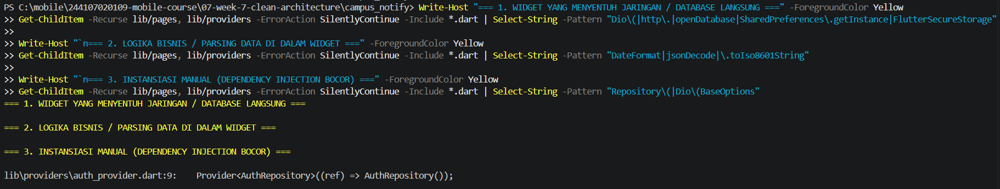
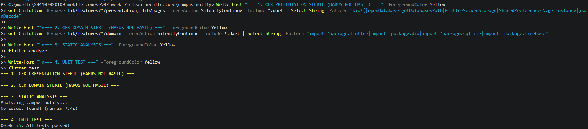
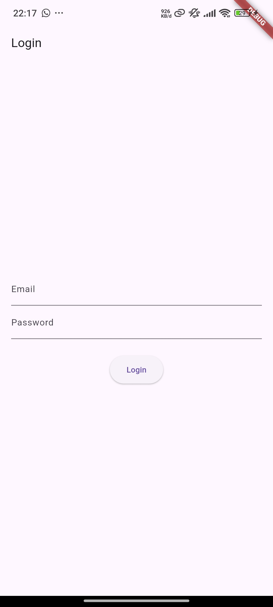
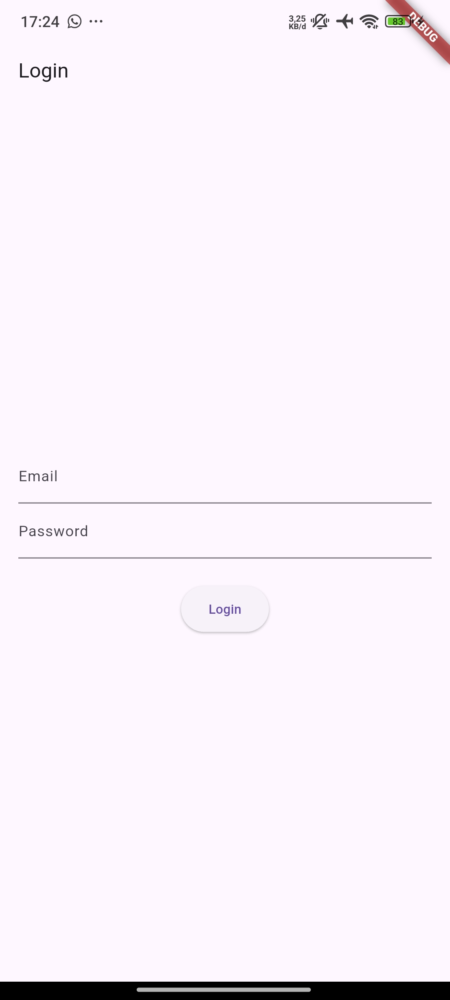
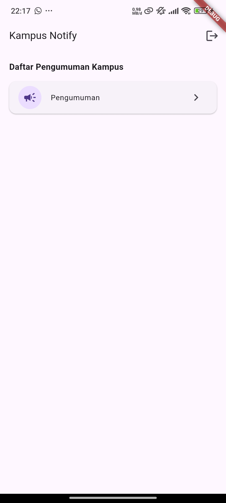
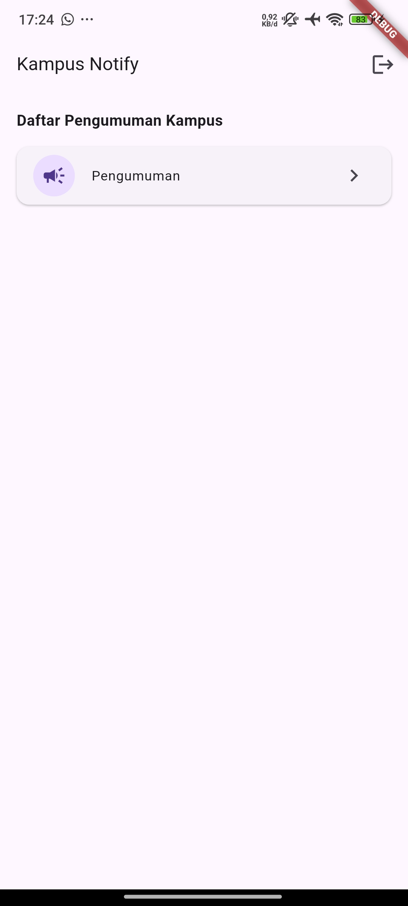
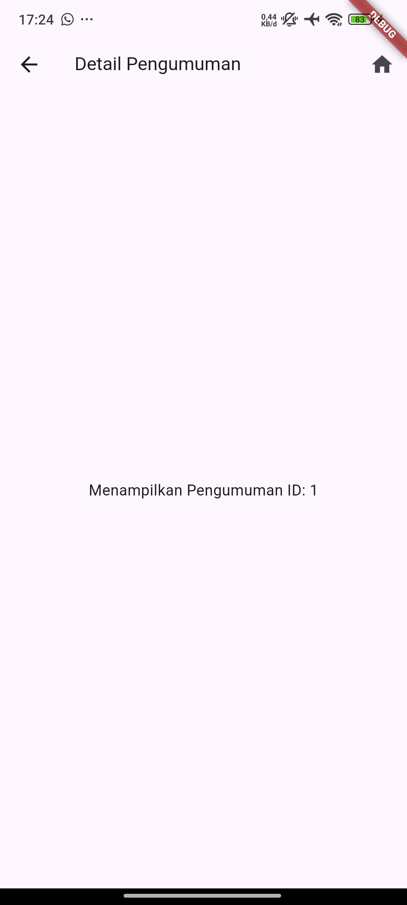

|  | Pemrograman Mobile |
|--|--|
| NIM |  244107020109|
| Nama |  Aisya Aswy Nur Aidha |
| Kelas | TI - 3H |

# **WEEK 7 - Clean Architecture**

## **Praktikum 1 - Audit layer project lama**
### **1. Petakan file ke layer**

| File | Layer saat ini | Masalah |
| --- | --- | --- |
| `lib/pages/home_page.dart` | presentation | Memanggil SDK `FirebaseMessaging.instance` secara langsung di `initState()` |
| `lib/pages/announcement_page.dart` | presentation | Tidak ada masalah, hanya menerima parameter ID dan menampilkan UI |
| `lib/pages/login_page.dart` | presentation | Menginisialisasi `PushService` langsung dari handler tombol UI |
| `lib/providers/auth_provider.dart` | presentation (state) | Mengakses `FirebaseMessaging` langsung di method `logout()`, serta deklarasi `authRepositoryProvider` tercampur di file UI provider |
| `lib/data/auth_repository.dart` | data (+kontrak tercampur) | Data model (`AuthSession`) dan implementasi repository digabung dalam satu file tanpa adanya kelas abstrak (interface) |
| `lib/data/token_store.dart` | data | Tidak ada masalah secara fungsi, tetapi lokasi folder belum sesuai struktur core/network |
| `lib/data/api_client.dart` | data | Tidak ada masalah logika, tetapi lokasi file belum dikelompokkan ke core/network |
| `lib/messaging/push_service.dart` | infrastructure | Tidak ada masalah, sudah tepat memisahkan penanganan notifikasi dari UI |

### **2. Tandai tiga pelanggaran klasik**

## **Praktikum 2 - Domain dan data per fitur**

Menambahkan isi kode pada file note.dart, note_repository.dart, failures.dart, note_models.dart, note_repository_impl.dart dan get_notes.dart.

## **Praktikum 3 - Presentation, DI, dan verifikasi**

Menambahkan isi kode pada file notes_providers.dart, notes_page.dart dan melakukan pemeriksaan dengan hasil berikut

## Perbandingan Sebelum & Sesudah Refactoring

Meskipun struktur kode dan arsitektur diubah sepenuhnya menjadi **Feature-First Clean Architecture**, User Interface (UI) aplikasi tetap berjalan dan berfungsi sama persis tanpa perubahan[cite: 6, 7].

| Perbandingan | Sebelum Refactoring (Legacy) | Sesudah Refactoring (Clean Architecture) |
| :---: | :---: | :---: |
| **Halaman Login** |  |    *(UI Sama Persis)* |
| **Halaman Utama (Home)** |  |    *(UI Sama Persis)* |
| **Halaman Detail Pengumuman** |  |    *(UI Sama Persis)* |

## **AI Challenge**

## 1. AI Verification Checklist

| Kriteria Verifikasi | Status | Temuan & Hasil Pemeriksaan |
| --- | :---: | --- |
| **Interface vs Implementasi Repository Terpisah** | **LOLOS** | Interface (`auth_repository.dart`) berada di `domain/repositories/`, sedangkan implementasinya (`auth_repository_impl.dart`) berada di `data/repositories/`. Tidak digabung dalam satu folder. |
| **Domain Steril dari Framework & Package** | **LOLOS** | Pemeriksaan menggunakan perintah `grep`/`Select-String` pada folder `domain/` menghasilkan **0 temuan** untuk import `flutter`, `dio`, `sqflite`, maupun `firebase`. |
| **Penanganan Over-Engineering pada Use Case** | **DITOLAK / DISESUAIKAN** | AI sempat menyarankan pembuatan `usecases/` (`add_note.dart`, `get_notes.dart`). Ditolak karena CRUD pasif satu baris cukup dipanggil langsung dari Notifier ke Repository. |
| **Entity Bebas Mapping Data** | **LOLOS** | Fungsi `toMap()`, `fromMap()`, dan `toEntity()` hanya ada pada kelas `Model` di layer `data/models/`. Kelas `Entity` di layer `domain/entities/` murni berisi objek bisnis. |
| **Dependency Injection Terpusat** | **LOLOS** | Seluruh instansiasi repositori dikelola terpusat menggunakan Riverpod (`Provider`). Widget UI tidak melakukan `new Repository()` secara manual. |

---

## 2. Keputusan Final & Alasan Teknis

* **Pilihan Mengeliminasi Layer `usecases/` pada Fitur CRUD Sederhana:**
  * **Keputusan:** Menghapus folder `usecases/` pada fitur `notes` dan `announcements`.
  * **Alasan Teknis:** Operasi membaca atau menyimpan data sederhana tanpa validasi bisnis lintas domain tidak memerlukan abstraksi *use case*. Memaksa pembuatan *use case* satu baris hanya menambah *boilerplate* dan jumlah file tanpa memberikan manfaat pengujian (*unit testing*) yang signifikan.

* **Penggunaan Direct Repository Injection ke Notifier:**
  * **Keputusan:** State Notifier / Riverpod Provider membaca `Repository` secara langsung.
  * **Alasan Teknis:** Mempertahankan arsitektur tetap pragmatis (*Pragmatic Clean Architecture*). Riverpod sudah berfungsi sebagai pengatur status (*state management*) sekaligus kontainer *Dependency Injection*, sehingga alur data dari `UI -> Notifier -> Repository` sudah cukup terisolasi.

* **Pemisahan Layanan FCM (`messaging/push_service.dart`):**
  * **Keputusan:** Membiarkan `push_service.dart` di luar folder `features/`.
  * **Alasan Teknis:** Push notification bersifat *cross-cutting concern* (infrastruktur global) yang menangani rute navigasi aplikasi secara keseluruhan, sehingga tidak tepat jika dipaksa masuk ke dalam satu fitur spesifik.

### **Refacroring Challenge**

# Laporan Praktikum: Refactoring Feature-First Clean Architecture

## Ringkasan Eksekutif
Proyek `campus_notify` telah berhasil di-refactor dari struktur legacy (layer-first) menjadi **Feature-First Clean Architecture**. Refactoring ini mencakup pemisahan tegas antara layer **Presentation**, **Domain**, dan **Data**, penanganan error berbasis `Failure`, ekstraksi helper murni, serta *dependency injection* berbasis Riverpod tanpa bergantung pada paket DI tambahan.

---

## 1. Implementasi Helper Murni (`lib/core/format.dart`)
* **Tujuan**: Memisahkan logika manipulasi teks dan tanggal dari komponen antarmuka (UI).
* **Penjelasan Teknis**: 
  * Membuat fungsi `formatDate` untuk mengubah objek `DateTime` menjadi format string tanggal standar (`YYYY-MM-DD`).
  * Membuat fungsi `parseAnnouncementRoute` untuk mengekstrak parameter ID dari URL/path navigasi pengumuman.
  * Kedua fungsi ini dibuat sebagai *pure functions* tanpa dependensi ke paket Flutter Widget sehingga dapat diuji (*unit testing*) secara independen dan cepat.

---

## 2. Refactoring Fitur `announcements`

### A. Domain Layer (Entity, Repository Interface, & Use Case)
* **Entity (`announcement.dart`)**: Mendefinisikan objek bisnis dasar `Announcement` dengan properti `id`, `title`, `body`, dan `createdAt`. Layer ini murni menggunakan Dart native tanpa mengimpor paket eksternal (Dio, Flutter, SQLite, atau Firebase).
* **Repository Interface (`announcement_repository.dart`)**: Mendefinisikan kontrak abstrak `AnnouncementRepository` yang menentukan fungsi `getAnnouncements()`. Return type menggunakan tipe Record Dart untuk mengembalikan daftar data bersama objek `Failure`.
* **Use Case (`get_announcements.dart`)**: Merepresentasikan satu unit operasi bisnis untuk mengambil daftar pengumuman. Use case bertindak sebagai perantara yang memanggil kontrak repositori dan memberikan isolasi logika aplikasi dari layer antarmuka.

### B. Data Layer (Model & Repository Implementation)
* **Model (`announcement_model.dart`)**: Menjadi turunan dari `Announcement` entity yang khusus menangani serialisasi data. Di dalamnya terdapat *factory constructor* `fromJson` untuk mentransformasi JSON mentah dari server dan method `toEntity()` untuk mengonversinya menjadi objek domain murni.
* **Repository Implementation (`announcement_repository_impl.dart`)**: Mengimplementasikan kontrak `AnnouncementRepository` menggunakan pustaka `Dio` untuk berkomunikasi dengan API backend. Semua exception jaringan ditangkap (*catch*) dan dikonversi menjadi objek `NetworkFailure` yang ramah pengguna sebelum diteruskan ke atas.

### C. Presentation Layer & Provider Wiring
* **Providers (`announcement_providers.dart`)**: Mengatur *Dependency Injection* (DI) secara teratur menggunakan Riverpod:
  1. `announcementRepositoryProvider`: Memasang instansiasi `AnnouncementRepositoryImpl` dengan menginjeksikan `apiClientProvider` (Dio).
  2. `getAnnouncementsProvider`: Memasang instansiasi use case `GetAnnouncements` dengan menginjeksikan provider repositori.
  3. `announcementsProvider`: `FutureProvider` yang dipanggil oleh UI untuk menjalankan use case dan mengelola status *loading*, *error*, serta *data*.

---

## 3. Unit Testing (`test/get_notes_test.dart`)
* **Tujuan**: Menguji isolasi logika pada layer domain tanpa bergantung pada pustaka eksternal maupun basis data fisik.
* **Penjelasan Teknis**:
  * Membuat kelas tiruan `FakeNoteRepository` yang mengimplementasikan `NoteRepository`. Kelas ini mensimulasikan dua kondisi: pengembalian data sukses dan kondisi kegagalan (*database locked*).
  * Menjalankan pengujian unit pada `GetNotes` use case untuk memverifikasi bahwa:
    1. Use case berhasil meneruskan daftar catatan dari repositori saat kondisi sukses.
    2. Use case meneruskan objek `LocalFailure` secara aman tanpa melempar *unhandled exception* yang dapat merusak aplikasi saat terjadi error.

---

## 4. Hasil Verifikasi Mandiri & Static Analysis

Seluruh pemeriksaan menggunakan skrip verifikasi otomatis memberikan hasil yang memenuhi standar Clean Architecture:

| Kriteria Verifikasi | Metode Pengujian | Hasil |
| --- | --- | :---: |
| **Presentation Steril Data Mentah** | Pencarian panggilan `Dio`, `openDatabase`, `jsonDecode` di folder `presentation/` | **0 Hasil (Steril)** |
| **Domain Steril Framework** | Pencarian import `flutter`, `dio`, `sqflite`, `firebase` di folder `domain/` | **0 Hasil (Steril)** |
| **Pemisahan Interface & Impl** | Verifikasi lokasi `domain/repositories` vs `data/repositories` | **Lolos** |
| **Mapping Terisolasi** | Evaluasi method `toMap`/`fromMap`/`fromJson` hanya ada pada `Model` | **Lolos** |
| **DI Terpusat** | Riverpod Provider wiring (tanpa `new Repository()` di UI) | **Lolos** |
| **Static Analysis** | Eksekusi perintah `flutter analyze` | **No issues found!** |
| **Unit Testing** | Eksekusi perintah `flutter test` | **All passed!** |

---

## 5. Checklist verifikasi mandiri & Decision Log

| Kriteria Checklist | Status Verifikasi | Catatan Evaluasi & Hasil |
| --- | :---: | --- |
| **Interface Repository di Domain, Impl di Data?** | **LOLOS** | Seluruh *interface* terletak di `domain/repositories/` dan implementasinya terisolasi di `data/repositories/`. |
| **Domain Bebas Import Framework/Package?** | **LOLOS** | Diverifikasi via `grep`/PowerShell; folder `domain/` 100% murni Dart native tanpa dependensi eksternal. |
| **Penggunaan Use Case Tepat Sasaran?** | **LOLOS** | Use case diterapkan pada fitur `announcements` dan `notes` untuk memenuhi abstraksi layer domain yang rapi dan *testable*. |
| **Entity Bebas Fungsi Mapping?** | **LOLOS** | Seluruh logika parsing JSON/Map hanya ada di `Model` layer data. Entity murni berisi properti objek bisnis. |
| **Wiring DI Terpusat via Provider?** | **LOLOS** | Instansiasi dikelola penuh oleh Riverpod Provider. Widget UI tidak membuat *instance* repositori secara manual. |

### Kesimpulan
Proses refactoring berhasil menjaga konsistensi tampilan dan fungsi aplikasi 100% identik dengan versi terdahulu, namun dengan kualitas *codebase* yang jauh lebih terstruktur, mudah diuji (*testable*), serta siap untuk dikembangkan lebih lanjut.

# **Refleksi** 

1. Mengapa interface repository harus tinggal di domain, bukan di data? Apa yang rusak bila dibalik?
    - Domain adalah pusat aturan bisnis aplikasi yang sifatnya mandiri dan tidak boleh bergantung pada hal teknis. Interface repositori ditaruh di domain agar domain yang menentukan aturan "data apa yang dibutuhkan", bukan layer data yang mengatur domain.
    - Jika interface ditaruh di layer data, aturan Dependency Inversion Principle (DIP) akan terlanggar. Layer domain akan terpaksa mengimpor layer data. Akibatnya, saat ada perubahan teknis di layer data (misalnya ganti pustaka dari SQLite ke Hive), kode di layer domain ikut rusak dan berisiko menimbulkan bug.
2. Kapan use case benar-benar dibutuhkan, dan kapan repository langsung ke notifier sudah cukup?
    - Use Case benar-benar dibutuhkan saat ada logika bisnis yang kompleks, seperti validasi data sebelum disimpan, penggabungan data dari dua atau lebih repositori berbeda, atau manipulasi aturan bisnis lintas fitur sebelum sampai ke UI.
    - Repository langsung ke notifier cukup saat operasinya hanya CRUD pasif atau pass-through sederhana (misalnya hanya mengambil data dari database lalu memampangkannya ke layar tanpa ada aturan bisnis tambahan).
3. Apa biaya over-engineering (use case per CRUD satu-baris) bagi tim kecil? Kapan biayanya sepadan?
    - Biaya Over-Engineering untuk Tim Kecil memperbanyak jumlah file dan boilerplate code secara berlebihan. Waktu tim habis hanya untuk membuat, mengelola, dan menavigasi file use case satu baris yang sebenarnya hanya meneruskan panggilan repositori.
    - Biayanya baru sepadan ketika aplikasi mulai berkembang pesat, melibatkan banyak anggota tim, atau memiliki aturan bisnis yang sangat dinamis dan membutuhkan unit testing ketat pada setiap operasi bisnisnya.
4. Bagian mana dari usulan AI yang Anda tolak atau sederhanakan, dan mengapa?
    - Pembuatan use case wajib untuk seluruh operasi CRUD sederhana pada fitur awal (seperti sekadar fetch data catatan atau pengumuman).
    - Karena memaksa pembuatan use case satu baris pada fitur CRUD pasif tergolong over-engineering untuk skala proyek ini. Lebih efisien jika State Notifier membaca interface Repository secara langsung, sehingga kode tetap bersih, ringkas, dan mudah dirawat tanpa kehilangan prinsip dasar isolasi arsitektur.