|  | Pemrograman Mobile |
|--|--|
| NIM |  244107020109|
| Nama |  Aisya Aswy Nur Aidha |
| Kelas | TI - 3H |

# **WEEK 8 - Mid Project Review & Code Review**

# Review Checklist & Audit Commit

## Simulasi Perbaikan Commit Buruk

| Pesan Commit Lama | Pesan Commit Baru (Conventional Commit) | Alasan Perubahan |
| :--- | :--- | :--- |
| `refactoring` | `refactor(auth): perbarui struktur provider dan token store` | Pesan lama terlalu umum, tidak menjelaskan kode bagian mana yang di-refactor |
| `Tampilan` | `style(ui): perbarui tata letak halaman utama` | Pesan lama ambigu, tidak menggunakan kata kerja aksi dan tipe commit konvensional |
| `last commit` | `fix(routing): perbaiki navigasi rute utama` | Pesan tidak deskriptif dan tidak memberikan informasi konteks perubahan kode |

# Review Checklist & Kesiapan Mid-Project 

## 1. Status Tiga Pemeriksaan Mesin (Clean Code & Hygiene)

- [x] **`flutter analyze`** — Bersih tanpa issue (`No issues found!`).
- [x] **`dart format`** — Kode terformat rapi pada proyek Minggu 6, 7, dan 8.
- [x] **`flutter test`** — Semua pengujian lulus (`All tests passed!`).

### Bukti Eksekusi Mesin:
* **Flutter Analyze:**
  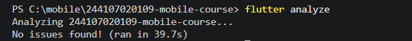

* **Dart Format:**
  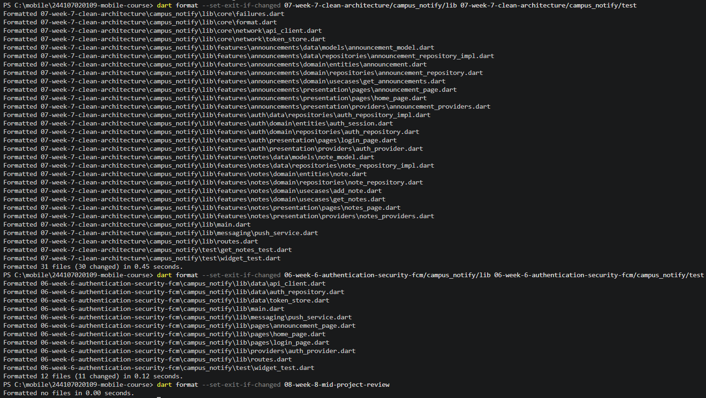

* **Flutter Test:**
  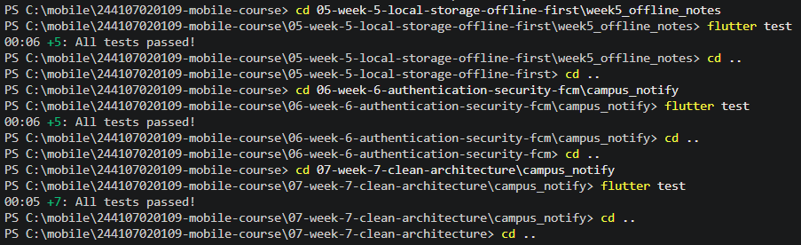

---

## 2. Audit Riwayat & Pembuatan Branch Baru

- [x] Memeriksa riwayat *commit* sebelumnya via `git log --oneline`.
- [x] Membuat branch `develop` dan branch fitur `feat/notes-validation`.

### Bukti Audit & Branching:
* **Audit Riwayat Git:**
  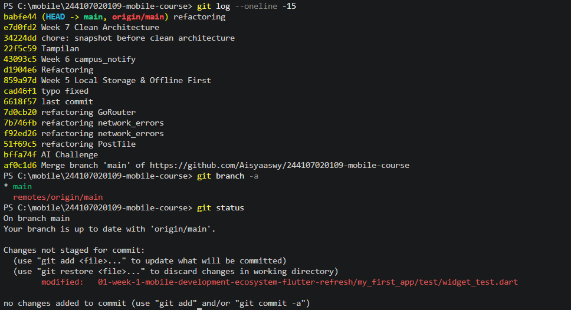

* **Pembuatan Branch Baru:**
  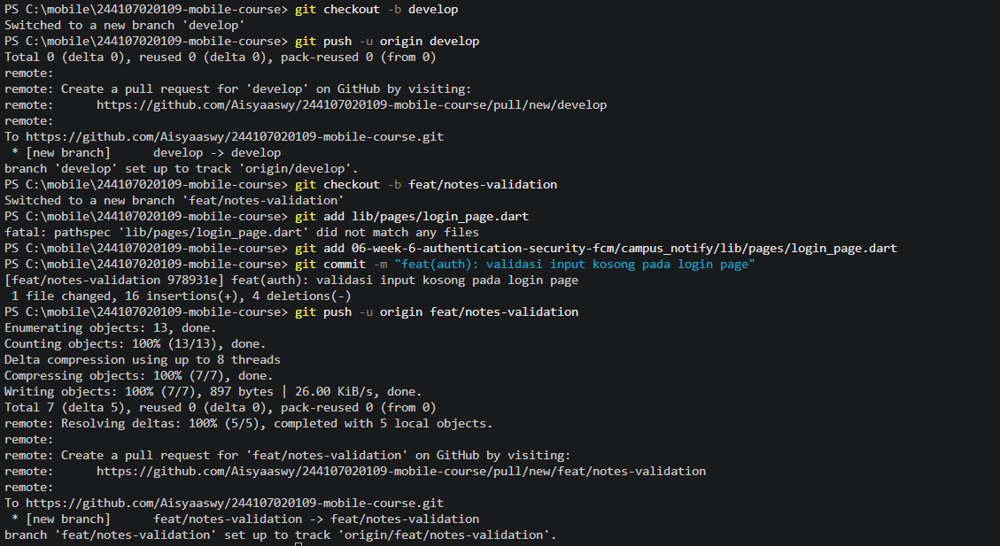

---

## 3. Hasil Peer Review & Workflow Git

- [x] **Branching:** Menggunakan branch `develop` sebagai basis serta branch fitur `feat/notes-validation`.
- [x] **Peer Review:** Pull Request telah ditinjau dan disetujui (*Approved*) oleh kawan sepasang (`naylaakas`).
- [x] **Squash and Merge:** PR berhasil digabung ke `develop` menggunakan teknik *Squash and Merge* untuk menjaga riwayat commit tetap bersih.
- [x] **Branch Hygiene:** Branch fitur `feat/notes-validation` telah dihapus dari repositori setelah proses merge selesai.

### Peta Issue & Pull Request:
| PR # | Judul PR | Author | Reviewer | Status |
| :--- | :--- | :--- | :--- | :--- |
| **#1** | `feat(auth): validasi input kosong pada login page` | Aisyaaswy | naylaakas | **Merged** |

### Bukti Alur Peer Review & Merge:
* **Pembuatan Pull Request:**
  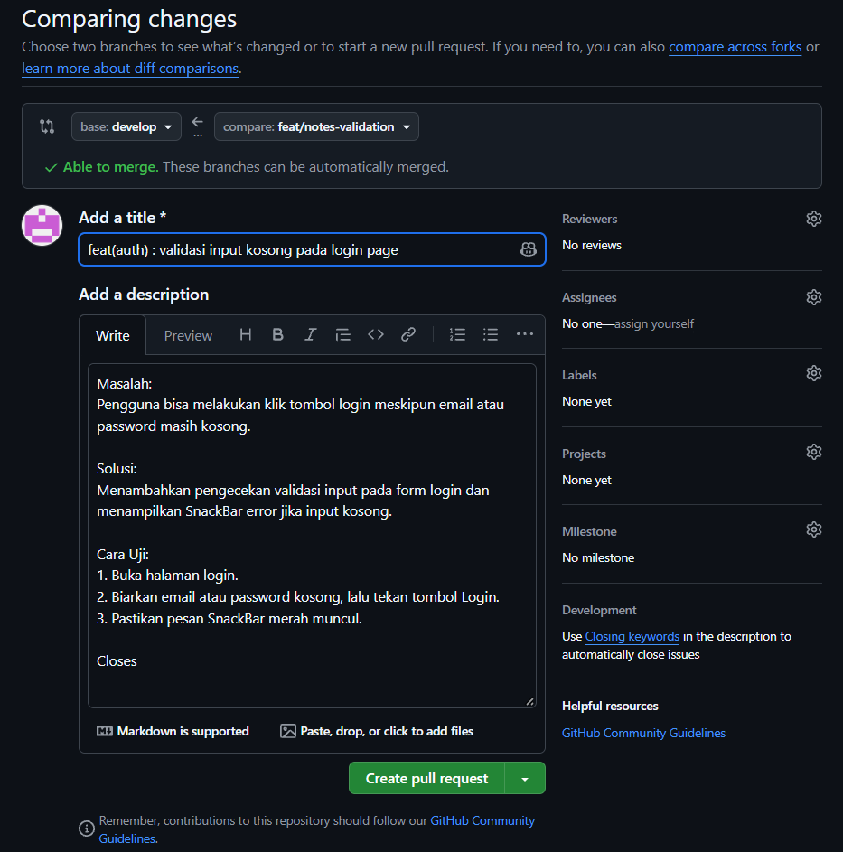

* **Review Sejawat (Approve):**
  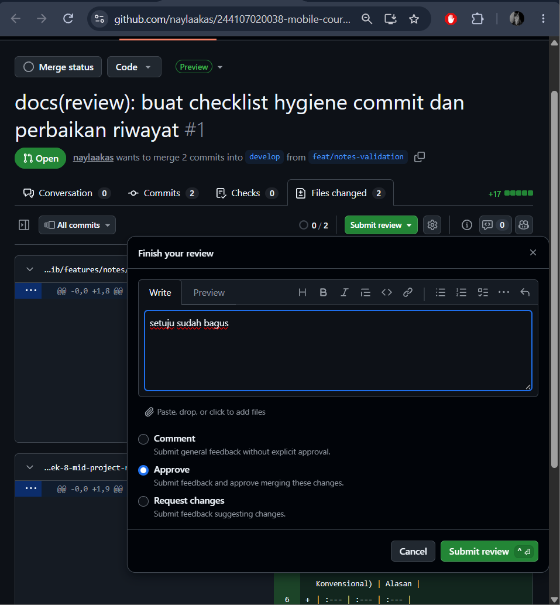

* **Proses Squash and Merge:**
  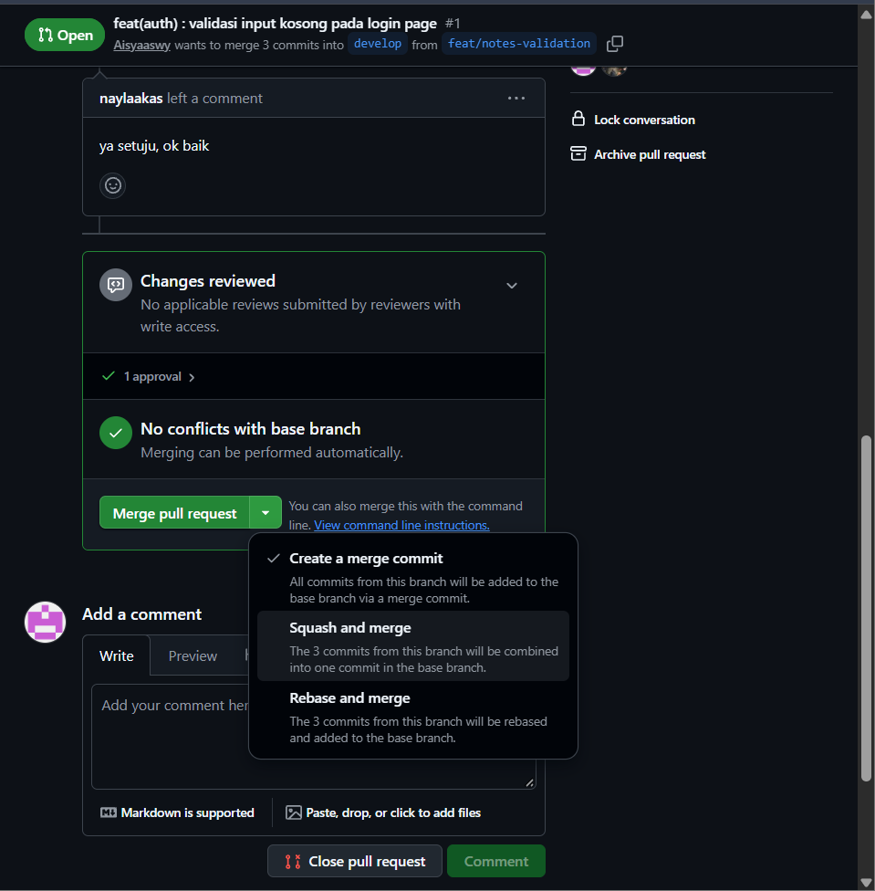

* **Status PR Merged:**
  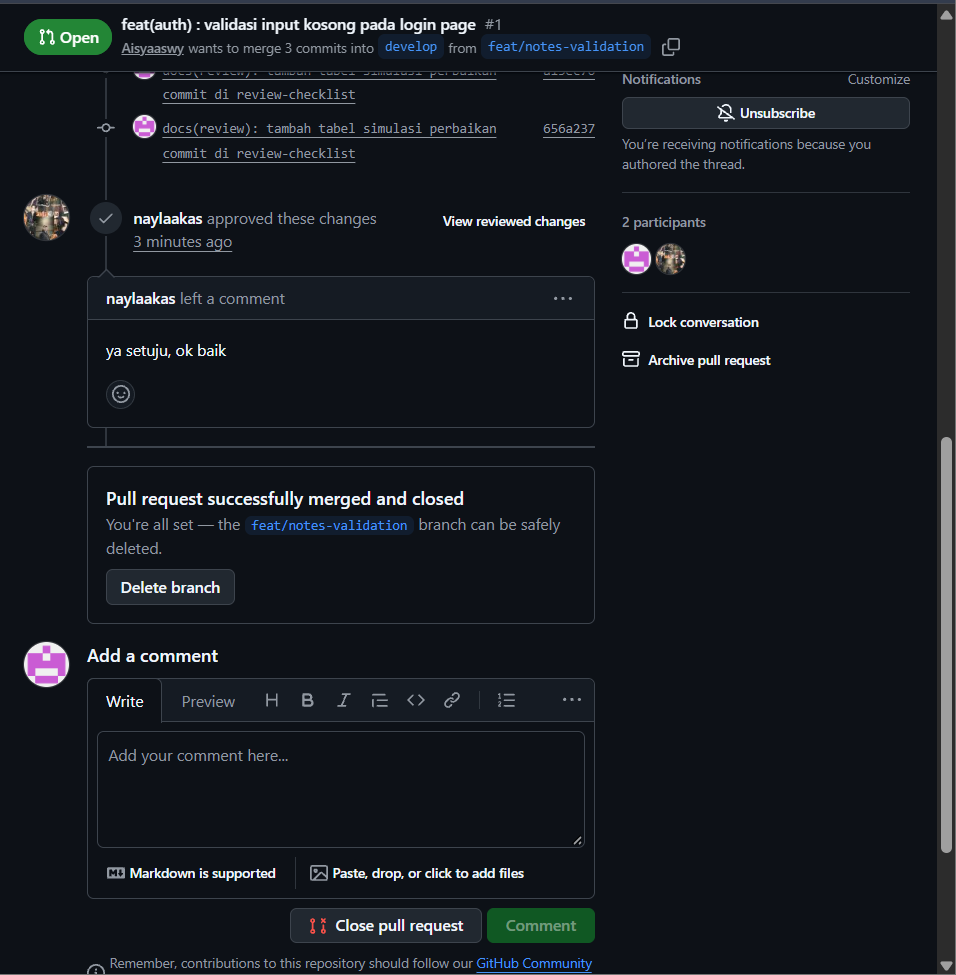

* **Penghapusan Branch Fitur:**
  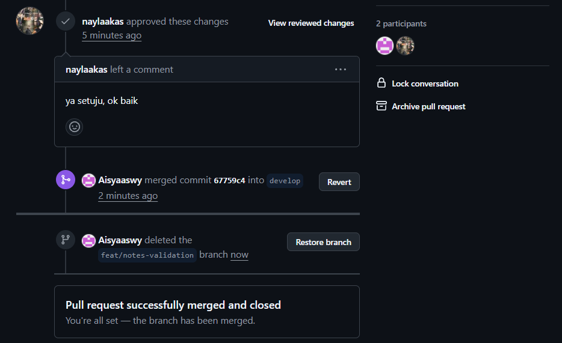

---

## 4. Otomatisasi CI/CD (GitHub Actions)

- [x] Berkas `.github/workflows/ci.yml` telah dibuat di root repositori untuk menjalankan `flutter analyze` dan `flutter test` secara otomatis pada setiap Pull Request.

### Bukti Konfigurasi CI Workflow:
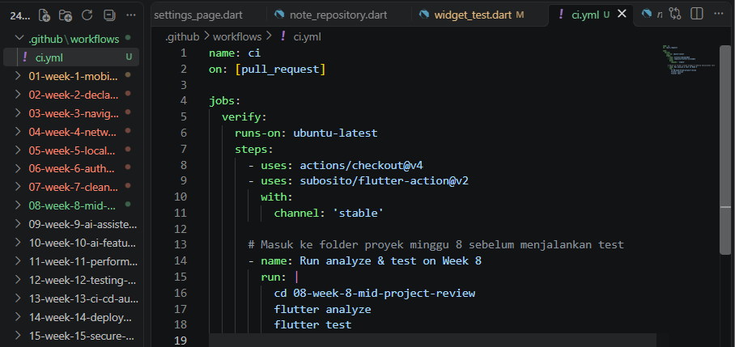

---

## 5. Ringkasan Kesiapan Paruh Semester

Aplikasi berjalan konsisten dan identik dengan capaian Minggu 7 dengan fondasi arsitektur Clean Architecture, pemeriksaan mesin yang hijau, serta alur kerja Git/PR berbasis kolaborasi yang siap dipergunakan untuk paruh kedua semester.

---

## 1. Verifikasi Temuan AI

### Temuan 1: Pelanggaran Batas Arsitektur pada Layer UI (Blocker)
* **Pemeriksaan:** Melakukan penelusuran kata kunci impor menggunakan perintah `grep` pada seluruh direktori fitur di layer presentation.
* **Hasil Bukti:** Ditemukan adanya impor langsung dari modul repository data konkrit pada berkas provider catatan. Hal ini terbukti melanggar aturan Clean Architecture karena layer presentation seharusnya hanya bergantung pada antarmuka abstrak di layer domain.
* **Keputusan Final:** **Diterima**. Dilakukan refactoring dengan menerapkan teknik overriding provider di berkas utama aplikasi, sehingga layer presentation murni hanya berinteraksi dengan antarmuka repository dari layer domain.

---

### Temuan 2: Kebocoran Abstraksi Penanganan Error Database (Blocker)
* **Pemeriksaan:** Verifikasi manual pada struktur berkas implementasi repository catatan di layer data.
* **Hasil Bukti:** Kode awal belum menangkap pengecualian spesifik dari SQLite secara terpisah, sehingga berisiko meneruskan exception teknis database langsung ke pemanggil.
* **Keputusan Final:** **Diterima**. Dilakukan penyesuaian penanganan exception dengan menangkap pengecualian database secara eksplisit dan membungkusnya ke dalam objek failure lokal sebelum dikembalikan ke layer atas.

---

### Temuan 3: Modifikasi Langsung State Riverpod (Blocker)
* **Pemeriksaan:** Penelusuran struktur mutasi state di seluruh notifier menggunakan perintah `grep`.
* **Hasil Bukti:** Tidak ditemukan adanya pemutasi objek state secara langsung. Pengelolaan state pada notifier sudah menerapkan alokasi data baru yang bersifat immutable.
* **Keputusan Final:** **Ditolak**. AI mengalami kesalahan analisis atau halusinasi konteks kode, karena struktur pengelolaan state yang ada di proyek sudah sesuai dengan prinsip immutability.

---

### Temuan 4: Potensi Masalah Async Gap pada Navigasi (Saran)
* **Pemeriksaan:** Verifikasi manual pada alur eksekusi asinkron di halaman login.
* **Hasil Bukti:** Terdapat pemanggilan fungsi asinkron secara berurutan tanpa pengecekan status konteks widget setelah proses pertama selesai. Hal ini berpotensi memicu masalah jika widget telah dilepas dari pohon tampilan sebelum proses berikutnya berjalan.
* **Keputusan Final:** **Diterima**. Ditambahkan pengecekan status ketersediaan widget terpasang tepat setelah baris proses asinkron pertama sebelum melanjutkan ke proses berikutnya.

---

### Temuan 5: Penggunaan Mock Kelas Konkret pada Unit Test (Saran)
* **Pemeriksaan:** Verifikasi berkas pengujian unit pada direktori test.
* **Hasil Bukti:** Kode pengujian unit yang ada sudah mem-mock antarmuka abstrak dari layer domain, bukan kelas implementasi dari layer data.
* **Keputusan Final:** **Ditolak**. Kode pengujian yang sudah ada di repositori sudah mengikuti standar pemosisian mock yang benar.

---

## 2. Peta Usulan AI vs Keputusan Final

| No | Temuan AI | Level | Hasil Verifikasi | Keputusan Final | Alasan Teknis |
| :--- | :--- | :--- | :--- | :--- | :--- |
| **1** | Presentation mengimpor kelas data konkrit | Blocker | Terbukti (`grep`) | **Diterima** | Melanggar aturan ketergantungan Clean Architecture; diselesaikan dengan provider override. |
| **2** | Kebocoran exception database ke layer atas | Blocker | Terbukti (Manual) | **Diterima** | Error teknis database harus dibungkus menjadi objek failure agar layer presentation steril. |
| **3** | Mutasi langsung pada State Riverpod | Blocker | Tidak Terbukti | **Ditolak** | Pengelolaan state sudah bersifat immutable; AI mengalami halusinasi konteks. |
| **4** | Eksekusi proses asinkron tanpa cek mounted | Saran | Terbukti (Manual) | **Diterima** | Diperlukan validasi ketersediaan widget untuk mencegah kesalahan saat runtime. |
| **5** | Mocking kelas konkret pada Unit Test | Saran | Tidak Terbukti | **Ditolak** | Pengujian unit sudah mem-mock antarmuka abstrak dari layer domain dengan tepat. |

---

## 3. Hasil Akhir Pemeriksaan Mesin

Seluruh perbaikan yang diterima telah diterapkan dan diverifikasi ulang menggunakan tiga pemeriksaan mesin:
* **`flutter analyze`:** Bersih tanpa kesalahan maupun peringatan.
* **`dart format`:** Seluruh berkas kode telah terformat sesuai standar.
* **`flutter test`:** Seluruh pengujian unit berjalan lancar dan lulus.

# **Refleksi** 

### 1. Beda LGTM Buta dengan Approve Bertanggung Jawab & Risikonya
LGTM buta adalah menyetujui kode tanpa mengecek isi dan jalurnya. Approve bertanggung jawab berarti memastikan kode memenuhi batas arsitektur dan lulus pengujian mesin. Risikonya, kode jadi berantakan, timbullah *bug* tersembunyi, dan aplikasi rentan *crash*.

### 2. Kapan Harus Request Changes vs Saran
Request changes wajib dipakai saat ada pelanggaran fatal, seperti UI yang mengambil data langsung dari layer data atau aplikasi yang gagal di-test. Saran digunakan untuk masukan kecil yang tidak merusak fungsi utama, seperti kerapian penamaan atau optimasi sederhana.

### 3. Bagian Review AI yang Ditolak dan Alasannya
Saya menolak temuan AI soal mutasi state Riverpod dan *mocking* test. AI salah menganalisis kode karena state aplikasi sudah *immutable* dan pengujian unit sudah memakai antarmuka domain yang benar.

### 4. Hal Konkret yang Diperbaiki dan Dampaknya
Saya menambahkan pengecekan `if (!mounted) return;` setelah proses login *async*. Dampaknya, aplikasi tidak akan *crash* jika pengguna berpindah halaman sebelum proses selesai.