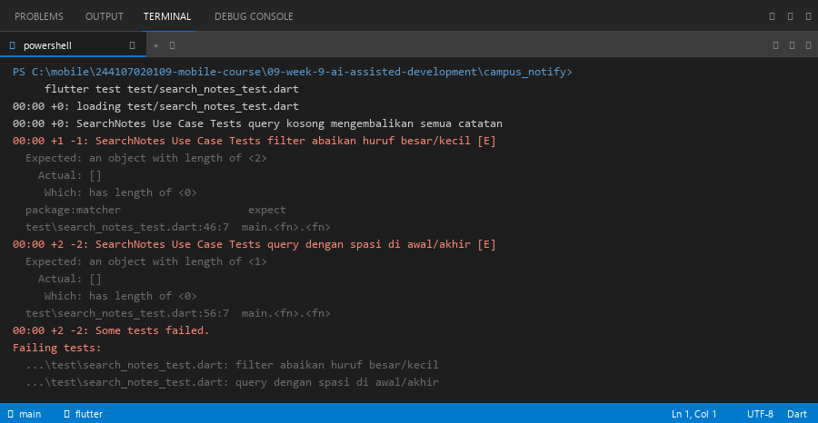
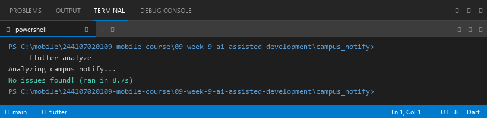
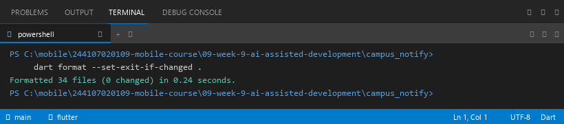
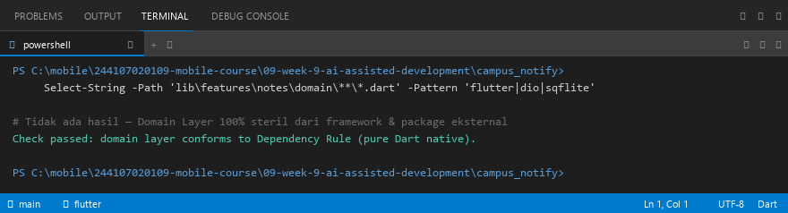
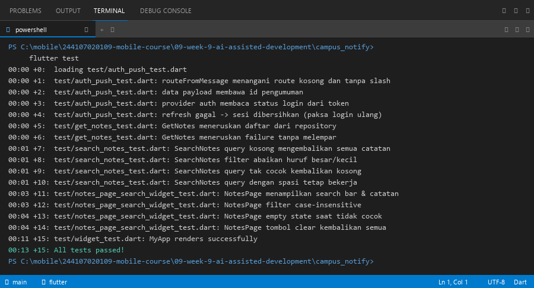

|  | Pemrograman Mobile |
|--|--|
| NIM |  244107020109|
| Nama |  Aisya Aswy Nur Aidha |
| Kelas | TI - 3H |

# **WEEK 9 — AI-Assisted Development / Vibe Coding**

> **Referensi Codelab**: [#09 Minggu 9 – AI-Assisted Development / Vibe Coding](https://jti-polinema.github.io/flutter-codelab/09-minggu-9-ai-assisted-development-vibe-coding/)

---

## Tujuan Pembelajaran

Setelah menyelesaikan codelab ini, mahasiswa mampu:
- Menjelaskan workflow AI-assisted development (prompt → generate → verify → test → refactor → explain).
- Menulis prompt dan konteks yang efektif untuk fitur Flutter kecil.
- Mengenali halusinasi dan keterbatasan AI pada kode Flutter.
- Melakukan debugging dan refactoring kode hasil AI ke Clean Architecture.
- Menguji kode hasil AI dengan `flutter analyze` dan `flutter test`.
- Mendokumentasikan prompt, hasil AI, keputusan terima/tolak, dan bukti uji di `docs/ai-log.md`.

---

## Kebijakan AI

> Minggu 9 adalah materi AI yang **dibolehkan secara bijak**. AI boleh mengusulkan kode, tetapi mahasiswa **wajib membaca tiap baris, memverifikasi API, menguji, me-refactor, dan menjelaskan keputusan tanpa membuka AI**. Nilai ada pada kualitas verifikasi dan alasan keputusan, bukan banyaknya kode AI.

---

## Konsep Workflow AI & Halusinasi

### Siklus Generate Sampai Explain

```
1. Prompt   → Instruksi + konteks proyek
2. Generate → AI mengusulkan kode
3. Verify   → Baca, grep, cek API nyata
4. Test     → flutter analyze + unit/widget test
5. Refactor → Rapikan ke Clean Architecture
6. Explain  → Jelaskan tanpa buka AI
```

> Gagal di langkah 3–6 berarti *vibe coding*: cepat di awal, mahal di akhir.

### Tiga Pola Halusinasi Flutter

| Halusinasi | Contoh pada Proyek Ini | Cara Deteksi |
|---|---|---|
| **Method fiktif** | `controller.searchFuzzy()` tidak ada | Cek autocomplete IDE & pub.dev |
| **Package kadaluarsa** | `StateProvider` (tidak ada di Riverpod 3.x) | Cek `pubspec.lock` dan CHANGELOG |
| **Logika yakin tapi salah** | `contains()` case-sensitive loloskan bug | Buktikan dengan satu test kecil |

---

## Persiapan Proyek

Codelab Minggu 9 ini melanjutkan proyek `campus_notify` hasil refactor Clean Architecture dari Minggu 7. Tidak membuat project baru.

```
09-week-9-ai-assisted-development/
├── campus_notify/          ← Proyek Flutter (feature-first clean architecture)
│   ├── lib/
│   │   └── features/notes/
│   │       ├── domain/usecases/search_notes.dart  ← Use case baru hasil refactor
│   │       └── presentation/
│   │           ├── pages/notes_page.dart          ← UI diperbarui (search bar + empty state)
│   │           └── providers/notes_providers.dart ← Provider Riverpod 3.x diperbarui
│   ├── test/
│   │   ├── auth_push_test.dart
│   │   ├── get_notes_test.dart
│   │   ├── search_notes_test.dart                 ← Unit test use case baru
│   │   ├── notes_page_search_widget_test.dart     ← Widget test fitur search
│   │   └── widget_test.dart
│   └── docs/
│       └── ai-log.md                              ← Log prompt, bug, dan keputusan
├── docs/
│   └── ai-log.md
├── screenshots/
│   ├── test_merah_bug_ai.png
│   ├── test_hijau_refactor.png
│   ├── flutter_analyze.png
│   ├── dart_format.png
│   └── domain_purity_grep.png
└── README.md (file ini)
```

---

## Praktikum 1: Prompt & Context Engineering

### Formula 5 Slot

Prompt yang baik mengisi lima slot berikut secara singkat:

```
Peran:    senior Flutter dev
Konteks:  feature-first, Riverpod, SQLite+Dio
Tugas:    tambah search judul notes + empty state
Batas:    jangan ubah arsitektur, maks 40 baris
Output:   kode + 3 test case + cara uji
```

### Buruk vs Baik

| Prompt | Keterangan |
|---|---|
| `"buatkan search notes yang keren"` | **Buruk** – kabur, tidak ada konteks arsitektur |
| `"Tambah search judul notes. Arsitektur: presentation→domain→data. Jangan panggil SQLite dari widget. Sertakan empty state + 1 widget test."` | **Baik** – spesifik, batas jelas, output terdefinisi |

### Prompt Aktual yang Digunakan

```text
Bertindaklah sebagai Senior Flutter Developer.
Proyek: 'campus_notify' — Feature-First Clean Architecture.
Stack: flutter_riverpod ^3.4.3, sqflite, dio.
Model domain:
  class Note { final int? id; final String title; final String body;
                final DateTime updatedAt; final bool dirty; }

Tugas: Buat fitur pencarian judul catatan secara in-memory + empty state.

Batasan:
1. UI → State (Notifier) → Use Case (Domain) → Repository
2. Jangan panggil SQLite langsung dari widget
3. Domain layer steril dari Flutter/Dio/SQLite
4. Pecah fungsi max 40 baris
5. Berikan 3 test case: query kosong, cocok, tidak cocok
```

---

## Praktikum 2: Generate & Verifikasi Search

### 1. Generate: Output Awal AI

AI mengusulkan kode berikut untuk use case (sebelum verifikasi):

```dart
// Usulan awal AI — BELUM DIVERIFIKASI
import 'package:flutter/foundation.dart'; // ← PELANGGARAN: framework di domain!
import '../entities/note.dart';

class SearchNotes {
  List<Note> call(List<Note> notes, String query) {
    if (query.isEmpty) return notes;
    // ← BUG: case-sensitive, tidak ada .toLowerCase() dan .trim()
    return notes.where((note) => note.title.contains(query)).toList();
  }
}

// Provider yang TIDAK VALID di Riverpod 3.x
final noteSearchQueryProvider = StateProvider<String>((ref) => ''); // ← HALUSINASI
```

### 2. Verifikasi 6 Langkah

| # | Langkah | Hasil Pemeriksaan |
|:---:|---|---|
| 1 | **Baca tiap baris** | Ditemukan import framework di domain, `contains` case-sensitive, API usang `StateProvider` |
| 2 | **Cek import `domain/`** | `import 'package:flutter/foundation.dart'` ditemukan → **wajib dibersihkan** |
| 3 | **Cek API nyata** | `StateProvider` tidak ada di Riverpod ^3.4.3, `searchFuzzy()` tidak ada di kontrak repositori |
| 4 | **`flutter analyze`** | `Error: Method not found: 'StateProvider'` |
| 5 | **Tulis test bukti (Test Merah)** | Test case-insensitive gagal: expected `hasLength(2)`, actual `[]` |
| 6 | **Uji manual** | Query kosong menampilkan semua; query 'zzz' menampilkan empty state |

### 3. Bukti Bug: Test Merah

```dart
test('filter abaikan huruf besar/kecil', () {
  final result = searchNotes(list, 'belanja');
  expect(result, hasLength(2)); // GAGAL dengan kode AI mentah
});
```

**Hasil eksekusi (kode AI mentah):**



---

## Praktikum 3: Debug & Refactor

### 1. Debug dengan Test Merah

Alur debug yang dilakukan:
1. **Reproduksi** — input `"belanja"` pada data berisi `"Belanja Mingguan"` dan `"Daftar BELANJA Elektronik"`.
2. **Isolasi** — pindahkan filter ke use case murni `SearchNotes` (domain layer, pure Dart).
3. **Test merah** — jalankan `flutter test test/search_notes_test.dart` → exit code 1.
4. **Perbaikan kecil** — tambahkan normalisasi string:

```dart
// domain/usecases/search_notes.dart — SETELAH REFACTOR
class SearchNotes {
  const SearchNotes();

  List<Note> call(List<Note> notes, String query) {
    final trimmedQuery = query.trim().toLowerCase();
    if (trimmedQuery.isEmpty) return notes;
    return notes
        .where((note) => note.title.toLowerCase().contains(trimmedQuery))
        .toList();
  }
}
```

5. **Catat akar masalah** di `docs/ai-log.md`.

### 2. Refactor ke Layer yang Benar

```
widget (UI saja)
  └─> notifier/provider (state & query Riverpod 3.x NotifierProvider)
        └─> use case  (aturan filter/search — domain layer, murni Dart)
              └─> repository (SQLite / Dio)
```

**Perubahan utama:**

| File | Perubahan |
|---|---|
| `domain/usecases/search_notes.dart` | **Baru** — use case murni, 0 import eksternal |
| `presentation/providers/notes_providers.dart` | Tambah `NoteSearchQueryNotifier`, `filteredNotesProvider` |
| `presentation/pages/notes_page.dart` | Tambah `NoteSearchBar`, `NotesEmptyView` (maks 40 baris/fungsi) |

### 3. Verifikasi Akhir

```bash
flutter analyze              # → No issues found!
dart format --set-exit-if-changed .  # → 0 changed
flutter test                 # → All tests passed! (15 tests)
```

**Hasil `flutter analyze`:**



**Hasil `dart format`:**



---

## AI Challenge

### AI Verification Checklist

| Kriteria Verifikasi | Status | Temuan & Hasil Pemeriksaan |
|---|:---:|---|
| **Domain steril dari framework & package** | **LOLOS** | Grep pada `domain/` menghasilkan **0 import** Flutter/Dio/SQLite. Use case murni Dart native. |
| **API package valid di versi aktif** | **LOLOS (setelah koreksi)** | `StateProvider` tidak ada di Riverpod 3.x → diganti `NotifierProvider<NoteSearchQueryNotifier, String>`. |
| **Logika filter case-insensitive** | **LOLOS (setelah koreksi)** | Bug ditemukan via test merah → diperbaiki dengan `.trim().toLowerCase()`. |
| **Pemisahan use case dari UI** | **LOLOS** | `SearchNotes` berada di `domain/usecases/`, tidak ada panggilan DB dari widget. |
| **Ukuran fungsi max 40 baris** | **LOLOS** | Seluruh method UI: 15–35 baris; tidak ada satupun melebihi batas. |
| **`flutter analyze` bersih** | **LOLOS** | `No issues found!` |
| **Test passed** | **LOLOS** | 15 tests, 0 failed (unit + widget + integrasi). |

**Bukti Domain Layer Purity:**



### Halusinasi yang Ditemukan & Cara Membuktikannya

#### 1. Bug Logika: Filter Case-Sensitive

- **Bukti**: Test merah pada `search_notes_test.dart`
- **Akar masalah**: `.contains(query)` tanpa `.toLowerCase()`
- **Koreksi**: `.trim().toLowerCase()` pada query dan judul

#### 2. Package Kadaluarsa: `StateProvider` (Riverpod 3.x)

- **Bukti**:
  ```
  Error: Method not found: 'StateProvider'.
  final noteSearchQueryProvider = StateProvider<String>((ref) => '');
  ```
- **Koreksi**: `NotifierProvider<NoteSearchQueryNotifier, String>` sesuai Riverpod 3.x API.

#### 3. Pelanggaran Batas Arsitektur

- **Bukti**: `import 'package:flutter/foundation.dart'` ditemukan di file domain
- **Koreksi**: Import dihapus; file use case kini 100% pure Dart native.

### Keputusan Final & Alasan Teknis (Decision Log)

| Usulan Kode AI | Keputusan | Alasan Teknis |
|---|:---:|---|
| Pembuatan use case `SearchNotes` | **DITERIMA** | Isolasi logika pencarian dari UI, memudahkan unit test murni tanpa mock widget. |
| `note.title.contains(query)` tanpa normalisasi | **DITOLAK** | Bug silent: filter gagal mendeteksi kata kunci berbeda kapitalisasi. Diganti dengan `toLowerCase()` + `trim()`. |
| `StateProvider<String>` untuk query | **DITOLAK** | Tidak ada di Riverpod 3.4.3. Diganti `NotifierProvider` + `Notifier<String>`. |
| `import 'package:flutter/foundation.dart'` di domain | **DITOLAK** | Melanggar Dependency Rule Clean Architecture. Domain wajib murni Dart. |
| `NotesEmptyView` dengan status pencarian | **DIMODIFIKASI** | Ditambahkan visual pembeda antara "database kosong" vs "tidak ditemukan". |
| Pemisahan widget `NoteSearchBar` | **DITERIMA** | Ukuran fungsi tetap di bawah 40 baris dan widget dapat diuji secara modular. |

---

## Hasil Verifikasi Mesin (All Tests Passed)

**Rangkuman hasil 15 unit & widget test:**



| File Test | Jumlah Test | Status |
|---|:---:|:---:|
| `test/auth_push_test.dart` | 4 | ✅ Passed |
| `test/get_notes_test.dart` | 2 | ✅ Passed |
| `test/search_notes_test.dart` | 4 | ✅ Passed |
| `test/notes_page_search_widget_test.dart` | 4 | ✅ Passed |
| `test/widget_test.dart` | 1 | ✅ Passed |
| **Total** | **15** | **✅ All Passed** |

---

## Refleksi

**1. Mengapa klaim AI harus diperlakukan sebagai hipotesis, bukan fakta final?**

AI menghasilkan kode berdasarkan pola statistik, bukan eksekusi nyata terhadap versi package yang dipakai. Pada praktikum ini, AI yakin `StateProvider` dan `contains()` benar — keduanya terlihat logis di permukaan namun gagal saat diuji terhadap runtime aktual (Riverpod 3.x) dan data riil (judul dengan kapitalisasi berbeda). Tanpa siklus verify → test → analyze, bug ini bisa lolos ke production tanpa gejala yang jelas karena aplikasi tetap berjalan namun memberikan hasil yang salah secara senyap (*silent bug*).

**2. Apa yang seharusnya TIDAK pernah ditempel ke AI?**

Token FCM, JWT, API key, atau secret apapun. Juga seluruh file repo yang besar (500 baris+) — karena token dapat bocor dan konteks yang terlalu besar membuat AI menghasilkan hallusinasi lebih banyak. Ganti dengan placeholder seperti `TOKEN_PLACEHOLDER` sebelum prompting.

**3. Bagian mana dari usulan AI yang ditolak dan mengapa?**

Tiga hal ditolak: import framework di layer domain (melanggar Dependency Rule), `StateProvider` yang sudah tidak ada di Riverpod 3.x (package kadaluarsa), dan filter `contains()` tanpa normalisasi (bug logika case-sensitive). Ketiganya berpotensi menyebabkan bug tersembunyi yang sulit dilacak tanpa test spesifik.

**4. Apa perbedaan antara "vibe coding" yang berbahaya vs AI-assisted yang bertanggung jawab?**

*Vibe coding berbahaya*: copy-paste output AI langsung ke repo tanpa membaca, menguji, atau memahami setiap baris. *AI-assisted yang bertanggung jawab*: AI mengusulkan, developer memverifikasi setiap baris, menulis test bukti sebelum menerima, memahami arsitektur yang dilanggar, dan mendokumentasikan keputusan. Nilai dan kepercayaan ada pada kualitas verifikasi dan pemahaman teknis, bukan pada volume kode yang dihasilkan AI.

---

Log prompt & keputusan: [`docs/ai-log.md`](docs/ai-log.md)

