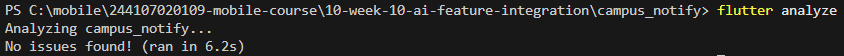
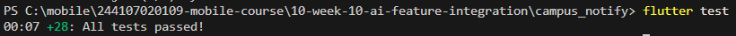
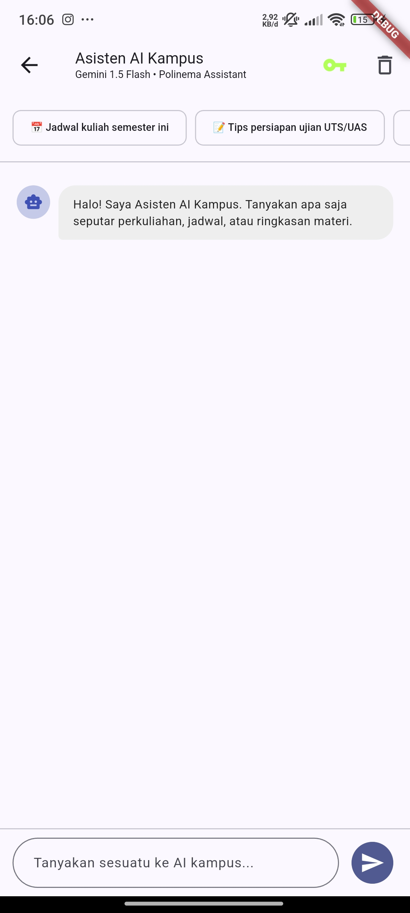
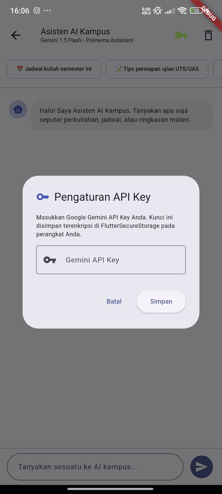
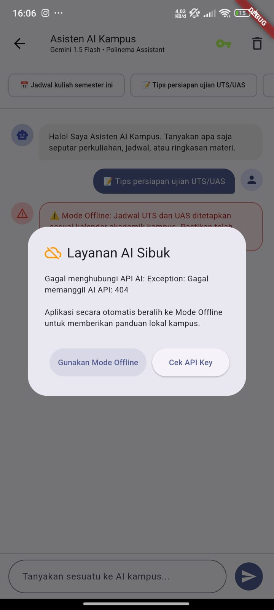

|  | Pemrograman Mobile |
|--|--|
| NIM | 244107020109 |
| Nama | Aisya Aswy Nur Aidha |
| Kelas | TI - 3H |

# **WEEK 10 — AI Feature Integration (Integrasi Fitur AI)**

> **Referensi Codelab**: [#10 Minggu 10 – Integrasi Fitur AI](https://jti-polinema.github.io/flutter-codelab/10-minggu-10-ai-feature-integration/index.html#5)

---

## 1. Ringkasan Fitur AI yang Diintegrasikan

Pada proyek **`campus_notify`**, fitur AI yang diintegrasikan adalah **Asisten AI Kampus (*AI Campus Assistant*)** menggunakan model **Google Gemini API** (`gemini-1.5-flash`), dipadukan dengan penyimpanan kredensial aman (**`flutter_secure_storage`**) dan mekanisme ketahanan **Offline FAQ Fallback**.

### Mengapa Fitur Chat Asisten Dipilih?
1. **Relevansi Kebutuhan Mahasiswa**: Mahasiswa membutuhkan asisten cerdas yang dapat menjawab informasi perkuliahan, jadwal kuliah, kalender akademik, tips ujian, maupun merangkum catatan kampus dengan cepat.
2. **Kesesuaian Modul Praktikum**: Modul Minggu 10 secara khusus memandu arsitektur percakapan cerdas yang mencakup *Secure Storage API Key*, *System Prompt Persona*, *Loading Indicator UX*, dan *Fallback Alert Dialog*.
3. **Penerapan Clean Architecture**: Logika pemanggilan AI diisolasi ke dalam layer data (`AiService`), diabstraksikan oleh domain (`AiChatRepository`), dan dikonsumsi oleh UI via Riverpod Notifier (`AiChatNotifier`).

### Diagram Arsitektur Integrasi AI
```
┌─────────────────────────────────────────────────────────────┐
│                   Flutter UI (ChatScreen)                   │
│   • Suggested Chips • Chat Bubbles • API Key Setup Dialog    │
└──────────────────────────────┬──────────────────────────────┘
                               │ State (Riverpod)
                               ▼
┌─────────────────────────────────────────────────────────────┐
│             Presentation: AiChatNotifier (Riverpod)          │
│               • State Management • Input Validation          │
└──────────────────────────────┬──────────────────────────────┘
                               │ Use / Depend
                               ▼
┌─────────────────────────────────────────────────────────────┐
│                 Domain: AiChatRepository                    │
│                 (Kontrak Antarmuka Murni)                    │
└──────────────────────────────┬──────────────────────────────┘
                               │ Implementasi
                               ▼
┌─────────────────────────────────────────────────────────────┐
│        Data Layer: AiChatRepositoryImpl & AiService         │
├──────────────────────────────┬──────────────────────────────┤
│  • Client Privacy Sanitizer  │  • Offline Local FAQ Caching │
│  • Secure Storage (API Key)  │  • Gemini REST API (v1beta)  │
└──────────────────────────────┴──────────────────────────────┘
```

---

## 2. Tabel Risiko dan Mitigasi (Privasi & Biaya)

Sesuai panduan Codelab Minggu 10 Bab 5, berikut adalah analisis risiko dan implementasi mitigasi pada aplikasi:

| Kategori Risiko | Potensi Dampak | Strategi Mitigasi pada Aplikasi | Status Implementasi |
|---|---|---|:---:|
| **Kebocoran Data Pengguna (Privasi)** | Data pribadi mahasiswa (NIK, password, kontak) terkirim ke server publik AI pihak ketiga. | 1. Penerapan filter lokal `_containsSensitiveData()` di `AiService` yang mencegat input mengandung format NIK (16 digit) dan kata kunci sensitif.<br>2. System prompt menginstruksikan AI untuk menolak meminta informasi personal. | **Terimplementasi** |
| **Pencurian API Key (Keamanan)** | Kunci API Gemini diekstrak melalui dekompilasi file APK jika di-hardcode di source code. | API Key **tidak pernah di-hardcode** di repositori. Disimpan secara terenkripsi di keystore/keychain perangkat menggunakan `flutter_secure_storage`. Pengguna memasukkan kunci melalui dialog UI. | **Terimplementasi** |
| **Lonjakan Biaya & Rate Limit (Biaya)** | Kuota API habis atau penagihan berlebih akibat *spamming* chat berulang. | 1. Pembatasan pengiriman pesan saat status `isLoading` aktif.<br>2. Prompt dipersingkat dan respons dibatasi maksimal 3 kalimat.<br>3. Penyediaan tombol reset/clear per sesi. | **Terimplementasi** |
| **API Error / Down / Kuota Habis (Ketersediaan)** | Layanan AI Google tidak dapat dihubungi atau offline, menyebabkan aplikasi macet/crash. | **Graceful Degradation**: Error ditangkap pada blok `try-catch`, memunculkan Fallback Alert Dialog *"Layanan AI Sibuk"*, dan otomatis mengalihkan jawaban ke basis pengetahuan lokal (*Offline FAQ*). | **Terimplementasi** |
| **Halusinasi AI / Jawaban Salah (Akurasi)** | Mahasiswa mendapatkan informasi jadwal ujian atau prosedur akademik yang keliru. | System prompt mendefinisikan *boundaries* yang jelas. Pada UI dicantumkan teks bahwa informasi dapat dikonfirmasi ke SIAKAD resmi. | **Terimplementasi** |

---

## 3. Jawaban Refleksi

### 1. Fitur AI mana yang Anda integrasikan dan mengapa?
> **Jawaban**:
> Saya mengintegrasikan fitur **AI Campus Chat Assistant** ke dalam proyek `campus_notify`. Fitur ini dipilih karena sangat relevan untuk membantu mahasiswa dalam mencari informasi akademik, jadwal kuliah, persiapan ujian, dan tips belajar secara interaktif langsung dari aplikasi mobile. Selain itu, fitur percakapan ini secara menyeluruh menerapkan seluruh konsep yang diajarkan pada Codelab Minggu 10, mulai dari prompt persona, secure storage untuk kredensial, indikator loading UX, hingga fallback dialog offline.

### 2. Bagaimana Anda melindungi privasi pengguna saat menggunakan AI API?
> **Jawaban**:
> Perlindungan privasi diterapkan pada dua tingkatan:
> 1. **Client-side Privacy Sanitization**: Pada `AiService`, sebelum teks dikirim melalui HTTP POST, sistem menjalankan fungsi `_containsSensitiveData(question)`. Jika terdeteksi format NIK 16 digit angka, kata sandi, atau data perbankan, proses dibatalkan seketika di perangkat dengan notifikasi peringatan privasi, sehingga data sensitif tidak pernah meninggalkan smartphone pengguna.
> 2. **System Prompt Guardrails**: System prompt secara eksplisit memberi batasan: *"Jangan pernah meminta atau memberikan data pribadi sensitif seperti NIK, password, atau nomor telepon."*
> 3. **Secure Credential Storage**: Token/API Key disimpan terenkripsi di `FlutterSecureStorage` perangkat dan tidak pernah dikirim ke pihak luar selain endpoint resmi Google Gemini.

### 3. Fallback apa yang Anda sediakan jika layanan AI error?
> **Jawaban**:
> Jika terjadi galat (koneksi putus, HTTP status bukan 200, atau kuota habis), aplikasi tidak mengalami crash melainkan mengeksekusi mekanisme fallback bertingkat:
> 1. **Fallback Alert Dialog**: Menampilkan modal dialog interaktif *"Layanan AI Sibuk — Coba lagi nanti atau gunakan mode offline"* lengkap dengan tombol untuk memeriksa API Key atau beralih ke mode offline.
> 2. **Offline FAQ Knowledge Base**: Melalui `getOfflineFaqAnswers()` pada layer repository, sistem menyediakan jawaban cadangan berbasis lokal seputar jadwal kuliah, periode UTS/UAS, dan pencarian catatan kampus yang tersimpan di SQLite lokal.

### 4. Satu hal yang Anda pelajari tentang UX fitur AI di mobile?
> **Jawaban**:
> Satu hal penting yang saya pelajari adalah bahwa **latensi respons dan transparansi status sangat memengaruhi kenyamanan pengguna (*User Experience*) di perangkat mobile**. Panggilan model AI generatif di cloud memerlukan waktu beberapa detik untuk memproses jawaban. Oleh karena itu, antarmuka wajib menyediakan *instant feedback* berupa indikator loading/mengetik yang jelas, tombol kirim yang dinonaktifkan saat memproses (*anti-spam*), pembatasan panjang teks (maksimal 2–3 kalimat) agar nyaman dibaca di layar HP tanpa scrolling panjang, serta penanganan error yang ramah dan solutif (*graceful fallback*) ketika pengguna berada di area dengan sinyal lemah.

---

## 4. Bukti Mesin Hijau (*Green Pipeline Verification*)

Seluruh pemeriksaan kode dan rangkaian pengujian otomatis berhasil dijalankan dengan status **HIJAU (100% Pass)**.

### A. Hasil `flutter analyze`



---

### B. Hasil `flutter test`



---

### C. Bukti Antarmuka Chat AI Asisten (*AI Campus Assistant*)



---

### D. Bukti Dialog Pengaturan API Key (*Flutter Secure Storage*)



---

### E. Bukti Dialog Fallback (*Graceful Degradation / Mode Offline*)



---

## 5. Ringkasan File Screenshot yang Disimpan

Seluruh tangkapan layar telah berhasil diambil dan disimpan pada folder `screenshots/`:

| Nama File Screenshot | Status | Deskripsi |
|---|:---:|---|
| `screenshots/flutter_analyze.png` | ✅ Lengkap | Terminal dengan hasil perintah `flutter analyze` menunjukkan **"No issues found!"**. |
| `screenshots/flutter_test.png` | ✅ Lengkap | Terminal dengan hasil perintah `flutter test` menunjukkan **"All tests passed!"** (28/28 tests passed). |
| `screenshots/ai_chat_screen.png` | ✅ Lengkap | Layar antarmuka Chat AI Asisten pada emulator/HP dengan bubble pesan dan rekomendasi prompt. |
| `screenshots/ai_api_key_dialog.png` | ✅ Lengkap | Dialog popup Pengaturan API Key yang aman via `FlutterSecureStorage`. |
| `screenshots/ai_fallback_dialog.png` | ✅ Lengkap | Dialog Fallback *"Layanan AI Sibuk"* saat offline / API belum terhubung. |

---

## 6. Struktur Direktori Proyek

```
10-week-10-ai-feature-integration/
├── campus_notify/
│   ├── lib/
│   │   ├── ai/
│   │   │   └── ai_service.dart                       ← Service REST API Gemini & Secure Storage
│   │   ├── features/
│   │   │   ├── ai_chat/                              ← Clean Architecture Fitur AI
│   │   │   │   ├── data/repositories/
│   │   │   │   │   └── ai_chat_repository_impl.dart  ← Implementasi repositori & Offline FAQ
│   │   │   │   ├── domain/
│   │   │   │   │   ├── entities/chat_message.dart    ← Entitas pesan chat
│   │   │   │   │   └── repositories/ai_chat_repository.dart
│   │   │   │   └── presentation/
│   │   │   │       ├── pages/chat_screen.dart
│   │   │   │       └── providers/ai_chat_provider.dart
│   │   │   ├── chat_screen.dart                      ← UI Halaman Chat Asisten (Langkah 3)
│   │   │   ├── announcements/
│   │   │   ├── auth/
│   │   │   └── notes/
│   │   ├── routes.dart                               ← Registrasi rute '/ai-chat'
│   │   └── main.dart
│   ├── test/
│   │   ├── ai_service_test.dart                      ← Unit test API, privasi, & storage
│   │   ├── ai_chat_repository_test.dart              ← Unit test offline FAQ fallback
│   │   ├── chat_screen_widget_test.dart              ← Widget test interaksi UI chat
│   │   └── ...
│   └── pubspec.yaml
├── docs/
│   └── ai-log.md                                     ← Log prompt sistem, user prompt, & evaluasi
├── screenshots/                                      ← Tempat file screenshot pengujian
└── README.md
```

