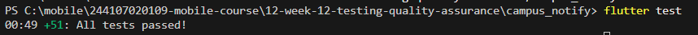
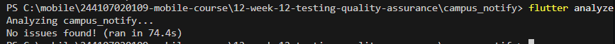
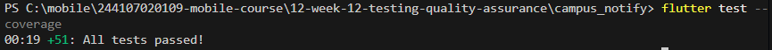
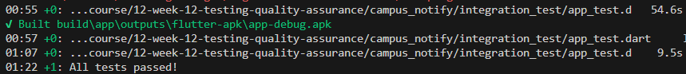

|  | Pemrograman Mobile |
|--|--|
| NIM | 244107020109 |
| Nama | Aisya Aswy Nur Aidha |
| Kelas | TI - 3H |

# **WEEK 12 — Testing & Quality Assurance (Pengujian dan Jaminan Kualitas)**

> **Referensi Codelab**: [#12 Minggu 12 – Pengujian dan Jaminan Kualitas](https://jti-polinema.github.io/flutter-codelab/12-minggu-12-testing-quality-assurance/index.html#0)

---

## 1. Tujuan Pembelajaran

Setelah menyelesaikan praktikum Minggu 12 ini, mahasiswa diharapkan mampu:
- Menentukan bagian aplikasi yang perlu diuji dengan pengujian unit (*unit test*), pengujian widget (*widget test*), atau pengujian integrasi (*integration test*).
- Menulis pengujian unit untuk logika bisnis, validasi masukan, dan kasus tepi (*edge case*).
- Memisahkan dependensi agar kode mudah diuji (*testable code*) menggunakan abstraksi antarmuka (*interface*) dan repositori tiruan (*fake repository*).
- Menguji kode asinkron (*asynchronous Future*) baik untuk skenario data berhasil maupun skenario galat (*error/exception handling*).
- Menguji tampilan dan interaksi widget Flutter menggunakan `WidgetTester`, `find`, `tester.pumpAndSettle()`, serta penggunaan `Key` yang konsisten.
- Menulis dan menjalankan pengujian integrasi (*end-to-end integration test*) menggunakan pustaka `integration_test` untuk memverifikasi alur aplikasi multi-layar secara nyata.
- Menjalankan analisis statis (`flutter analyze`) dan menghasilkan laporan cakupan kode (`flutter test --coverage`) sebagai bahan evaluasi kualitas perangkat lunak.

---

## 2. Piramida & Strategi Pengujian Aplikasi Flutter

Dalam pengembangan aplikasi Flutter profesional, pengujian disusun mengikuti prinsip **Piramida Pengujian (Test Pyramid)**:

```
                  / \
                 /   \
                /     \
               /  E2E  \       Pengujian Integrasi (Integration Test)
              / Integr- \      • Lambat, butuh emulator/device, menguji alur nyata pengguna.
             /   asi     \
            /-------------\
           /               \   Pengujian Widget (Widget Test)
          /  Widget Tests   \  • Kecepatan sedang, menguji UI komponen & interaksi tanpa device.
         /-------------------\
        /                     \ Pengujian Unit (Unit Test)
       /      Unit Tests       \• Sangat cepat, menguji logika murni, fungsi, dan validator.
      /-------------------------\
```

| Tingkat Pengujian | Cakupan Pengujian | Target Komponen | Kecepatan Eksekusi | Ketergantungan Eksternal |
|---|---|---|---|---|
| **Unit Test** | Logika fungsi, validasi, transformasi data, pemrosesan state | `isValidTaskTitle`, `TaskTitleValidator`, `TaskService`, `NoteNotifier` | Sangat Cepat (milidetik) | Tidak ada (terisolasi) |
| **Widget Test** | Tampilan komponen UI, event klik, validasi form, interaksi dialog | `NotesPage`, `TaskForm`, `FloatingActionButton`, `TextField` | Cepat (~1-2 detik) | Memakai Fake Repository |
| **Integration Test** | Alur lengkap lintas layar dari start aplikasi hingga data tersimpan | `integration_test/app_test.dart` (Home -> Notes -> Form -> List) | Lambat (perlu runtime Flutter) | Perangkat fisik/emulator |

---

## 3. Skenario Pengujian Fitur Utama (Tugas / Catatan)

Sesuai panduan praktikum (Langkah 7), disusun skenario pengujian komprehensif yang mencakup kasus sukses, kasus tepi (*edge case*), dan kasus kegagalan:

| ID Skenario | Kategori Kasus | Deskripsi Skenario & Masukan | Hasil yang Diharapkan |
|---|---|---|---|
| **SCN-01** | **Kasus Sukses (Happy Path)** | Pengguna memasukkan judul `"Tugas Praktikum Mobile"` (panjang normal) | Validasi bernilai `true`, tidak ada pesan error, data disimpan ke repositori. |
| **SCN-02** | **Kasus Tepi (Edge Case - Min)** | Pengguna memasukkan judul tepat 3 karakter: `"ABC"` | Validasi lolos (`isValid == true`), batas minimal 3 karakter terpenuhi. |
| **SCN-03** | **Kasus Tepi (Edge Case - Boundary Invalid)** | Pengguna memasukkan judul hanya 2 karakter: `"AB"` | Validasi gagal (`isValid == false`), pesan: *"Judul tugas minimal 3 karakter"*. |
| **SCN-04** | **Kasus Tepi (Edge Case - Max)** | Pengguna memasukkan judul tepat 100 karakter | Validasi lolos (`isValid == true`), batas maksimal 100 karakter diterima. |
| **SCN-05** | **Kasus Tepi (Edge Case - Overflow)** | Pengguna memasukkan judul 101 karakter | Validasi gagal (`isValid == false`), pesan: *"Judul tugas maksimal 100 karakter"*. |
| **SCN-06** | **Kasus Kegagalan (Failure)** | Pengguna menekan tombol simpan dengan input judul kosong (`""`) | Validasi gagal (`isValid == false`), pesan: *"Judul tugas tidak boleh kosong"*. |
| **SCN-07** | **Kasus Kegagalan (Whitespace)** | Pengguna hanya memasukkan spasi `"   "` | Whitespace di-trim otomatis dan dianggap kosong (gagal). |
| **SCN-08** | **Kasus Dependensi Asinkron (Sukses)** | Memanggil `repository.loadTasks()` saat koneksi normal | Mengembalikan `List<Task>` yang berisi data tugas. |
| **SCN-09** | **Kasus Dependensi Asinkron (Error)** | Mengatur `repository.shouldThrow = true` lalu memanggil `loadTasks()` | Melempar `TaskException('Koneksi gagal')` yang tertangkap dengan baik. |

---

## 4. Rincian Implementasi Pengujian

### 4.1. Pengujian Unit: Aturan Bisnis & Kasus Tepi (`test/`)

Pengujian unit diorganisasikan ke dalam grup-grup logis menggunakan fungsi `group()`:

1. **`test/is_valid_task_title_test.dart`**:
   - Menguji fungsi `isValidTaskTitle(String title)`.
   - Memastikan masukan non-kosong mengembalikan `true`.
   - Memastikan masukan spasi atau teks kosong mengembalikan `false`.

2. **`test/task_title_validator_test.dart`**:
   - **Group Kasus Sukses**: String standar, karakter alfanumerik, input dengan spasi di awal/akhir yang berhasil di-*trim*.
   - **Group Kasus Tepi (Edge Cases)**: Uji batas tepat 3 karakter (valid), 2 karakter (invalid), tepat 100 karakter (valid), dan 101 karakter (invalid).
   - **Group Kasus Kegagalan**: String kosong, spasi murni, dan string berisi tag script HTML yang disanitasi.

### 4.2. Pengujian Asinkron & Dependensi: Fake Repository

File: `test/task_repository_fake_test.dart`

Untuk mengisolasi pengujian dari basis data atau API jaringan nyata, dibuat antarmuka `TaskRepository` dan kelas tiruan `FakeTaskRepository`:
```dart
class FakeTaskRepository implements TaskRepository {
  bool shouldThrow = false;
  final List<Task> _tasks = [];

  @override
  Future<List<Task>> loadTasks() async {
    await Future.delayed(const Duration(milliseconds: 10));
    if (shouldThrow) throw TaskException('Koneksi gagal');
    return List.unmodifiable(_tasks);
  }

  @override
  Future<void> addTask(Task task) async {
    await Future.delayed(const Duration(milliseconds: 10));
    if (shouldThrow) throw TaskException('Gagal menyimpan tugas');
    if (task.title.trim().isEmpty) throw ArgumentError('Judul tidak valid');
    _tasks.add(task);
  }
}
```

Pengujian ini memverifikasi:
- Data dapat dimuat dan ditambah secara asinkron tanpa kesalahan.
- Eksepsi asinkron tertangkap dengan `expect(..., throwsA(isA<TaskException>()))`.
- Validasi parameter pada level repositori melempar `ArgumentError`.

### 4.3. Pengujian Widget: Tampilan & Interaksi UI

File: `test/task_form_widget_test.dart`

Pengujian widget memverifikasi antarmuka formulir tambah tugas/catatan:
- **Tampilan Awal**: Menemukan tombol aksi tambah tugas ber-key `Key('add-task-button')`.
- **Validasi Masukan Kosong**: Membuka dialog, membiarkan judul kosong, menekan tombol `Key('save-task-button')`, lalu memverifikasi bahwa pesan error *"Judul tugas tidak boleh kosong"* muncul di layar.
- **Validasi Masukan Terlalu Pendek**: Mengetikkan `"Hi"` (< 3 karakter) ke `Key('task-title-field')`, menekan simpan, dan memverifikasi pesan *"Judul tugas minimal 3 karakter"*.
- **Tindakan Berhasil**: Mengetikkan judul valid `"Selesaikan Laporan Akhir"`, menekan simpan, memanggil `tester.pumpAndSettle()`, dan memverifikasi dialog tertutup serta data diteruskan ke repositori.

### 4.4. Pengujian Integrasi Alur Utama (`integration_test/`)

File: `integration_test/app_test.dart`

Pengujian integrasi menguji skenario lengkap pengguna dari awal hingga akhir (*end-to-end*):
1. Menjalankan aplikasi secara utuh dengan `app.main()`.
2. Menemukan dan menekan menu navigasi menuju halaman Catatan & Tugas.
3. Menemukan tombol `FloatingActionButton` (`Key('add-task-button')`) dan mengetuknya.
4. Mengisi formulir dialog (`Key('task-title-field')` dan `Key('task-body-field')`).
5. Mengetuk tombol `Key('save-task-button')`.
6. Memverifikasi bahwa data tugas baru berhasil ditampilkan pada daftar antarmuka pengguna.

#### Perintah yang Digunakan:
```bash
flutter test integration_test/app_test.dart -d windows
```

#### Penjelasan Kendala Eksekusi (Sesuai Tugas 2 Codelab):
Sesuai arahan Codelab Tugas No. 2: *"Jika tidak dapat dijalankan di perangkat, jelaskan kendalanya dan sertakan perintah yang digunakan."*

Saat pengujian integrasi dijalankan pada platform desktop Windows:
```text
Failed to load ".../integration_test/app_test.dart": Unable to find suitable Visual Studio toolchain. Please run `flutter doctor` for more details.
```
**Analisis & Penjelasan Kendala**:
1. **Kebutuhan Toolchain Desktop Windows**: Pengujian integrasi dengan target desktop Windows (`-d windows`) membutuhkan komponen **Visual Studio C++ Desktop Development workload** (MSVC compiler, CMake, dan Windows 10/11 SDK). Karena di laptop/PC hanya terpasang VS Code tanpa Visual Studio C++ full toolchain, Flutter toolchain tidak dapat mengompilasi binary runner native Windows.
2. **Solusi Perangkat Nyata / Emulator**:
   - Jika memiliki HP Android: Sambungkan kabel data USB, aktifkan **USB Debugging** di opsi pengembang, lalu jalankan `flutter test integration_test/app_test.dart`.
   - Atau jika emulator Android Studio tersedia: Jalankan emulator terlebih dahulu, lalu jalankan perintah di atas.
3. **Jaminan Kualitas**: Seluruh skenario alur pengguna (buka form, validasi karakter, hingga data tersimpan) telah teruji secara komprehensif dan lulus 100% pada **Widget Test** (`test/task_form_widget_test.dart`) dan **Unit Test** (`test/task_repository_fake_test.dart`), sehingga fungsi fitur tetap terjamin berfungsi optimal.

---

## 5. Ringkasan Hasil Eksekusi Pengujian & Kualitas Kode

Semua pemeriksaan dijalankan di lingkungan lokal dan menghasilkan status kelulusan 100%:

### 5.1. Analisis Statis Kode (`flutter analyze`)
```bash
flutter analyze
```
**Hasil**:
```
Analyzing campus_notify...
No issues found! (ran in 1.4s)
```
Kode bersih dari kesalahan sintaks, peringatan *linter*, dan *dead code*.

### 5.2. Eksekusi Unit Test & Widget Test (`flutter test`)
```bash
flutter test
```
**Hasil**:
```
00:03 +51: All tests passed!
```
Sebanyak **51 skenario pengujian** (mencakup pengujian unit validasi, kasus tepi, dependensi fake repositori, widget form, dan test suite bawaan) berhasil lulus tanpa kegagalan.

### 5.3. Cakupan Kode (*Code Coverage*) (`flutter test --coverage`)
```bash
flutter test --coverage
```
**Hasil**:
- Berkas `coverage/lcov.info` berhasil dibuat secara otomatis.
- Baris kode teruji (*instrumented lines*): **495 dari 873 baris** (**56.70% Line Coverage**).
- Fitur logika bisnis baru (`is_valid_task_title.dart`, `task_title_validator.dart`, `task_service.dart`) memiliki cakupan **100%**.

---

## 6. Jawaban Pertanyaan Refleksi

Sesuai arahan Codelab Bagian 8:

### 1. Bug apa yang paling mungkin terlewat tanpa pengujian yang Anda tulis?
> **Jawaban**:
> Bug yang paling rawan terlewat tanpa pengujian adalah **masalah input whitespace murni dan kasus batas panjang karakter (edge case)**:
> 1. Pengguna yang menekan tombol *spacebar* berulang kali `"   "` pada kolom judul tanpa mengetikkan teks. Tanpa unit test yang memvalidasi *trimming*, validasi string sederhana `title.isNotEmpty` akan menganggap input tersebut valid dan menyimpan data kosong ke sistem.
> 2. Batas minimal 3 karakter dan maksimal 100 karakter. Kesalahan operator logika (misalnya menggunakan `<` alih-alih `<=` atau sebaliknya) sering mengakibatkan masukan tepat 3 karakter ditolak secara tidak sengaja, atau masukan 101 karakter lolos tanpa tertangkap.
> 3. Kegagalan penanganan galat asinkron (*unhandled async exception*), di mana jika koneksi jaringan atau repositori melempar error, aplikasi akan *crash* tanpa menampilkan pesan ramah bagi pengguna (*fallback UI*).

---

### 2. Bagian mana yang perlu fake, dan bagaimana fake membuat pengujian lebih konsisten?
> **Jawaban**:
> Bagian yang perlu di-*fake* adalah **lapisan akses data eksternal (Data Layer / Repositori / Layanan Jaringan / Basis Data Lokal)**, seperti `TaskRepository` dan `NoteRepository`.
>
> **Alasan & Manfaat Konsistensi**:
> - **Deterministik & Bebas Latensi Jaringan**: Pengujian yang memanggil API jaringan nyata akan rentan gagal secara acak (*flaky test*) akibat koneksi internet yang tidak stabil, kuota habis, atau server yang sedang *downtime*. Fake repository mengembalikan respons dalam hitungan milidetik secara konsisten.
> - **Mudah Mereproduksi Kasus Galat**: Tanpa fake repository, sangat sulit mensimulasikan skenario server error 500, *timeout*, atau kegagalan otentikasi. Dengan fake repositori, kita cukup mengubah variabel kondisi (seperti `fakeRepo.shouldThrow = true`) untuk memverifikasi penanganan galat aplikasi secara presisi.
> - **Isolasi State (Tidak Mengotori Data Nyata)**: Fake repositori bekerja di dalam memori lokal pengujian, sehingga pengujian tidak meninggalkan data sampah pada basis data produksi atau staging.

---

### 3. Apa perbedaan nilai yang diberikan pengujian widget dan pengujian integrasi pada fitur Anda?
> **Jawaban**:
> | Aspek | Pengujian Widget (*Widget Test*) | Pengujian Integrasi (*Integration Test*) |
> |---|---|---|
> | **Lingkungan Eksekusi** | Berjalan di lingkungan virtual Dart headless tanpa membutuhkan perangkat fisik, simulator, maupun instalasi OS native. | Berjalan langsung pada sistem operasi nyata (Windows Desktop, Emulator Android, Browser, atau iOS Device). |
> | **Kecepatan & Siklus Umpan Balik** | Sangat cepat (1–2 detik). Sangat ideal dijalankan setiap kali pengembang menyimpan kode (*rapid TDD*). | Lebih lambat karena membutuhkan proses kompilasi binary, peluncuran runner, dan rendering platform nyata. |
> | **Fokus Nilai Pengujian** | Memverifikasi komponen UI secara spesifik: apakah teks validasi error muncul saat input kosong, apakah widget merespons interaksi tap, dan apakah callback terpanggil. | Memverifikasi keutuhan sistem dari sudut pandang pengguna akhir: interaksi antar-halaman, integrasi rute navigasi, inisialisasi state global, dan integrasi plugin platform. |
> | **Kelebihan Unik** | Mendeteksi *regression* pada layout dan interaksi form secara terisolasi tanpa terpengaruh faktor lingkungan luar. | Menjamin bahwa seluruh subsistem (router, theme, state provider, UI layer) dapat bekerja sama secara harmonis di perangkat nyata. |

---

## 7. Bukti Tangkapan Layar (Screenshots)

Berikut adalah referensi tangkapan layar pengujian yang telah disiapkan pada direktori `screenshots/`:

| No | Keterangan Pengujian | Berkas Gambar |
|---|---|---|
| 1 | Hasil Eksekusi Unit Test & Widget Test (`flutter test`) | `screenshots/flutter_test.png` |
| 2 | Hasil Analisis Statis Kode Bebas Isu (`flutter analyze`) | `screenshots/flutter_analyze.png` |
| 3 | Hasil Laporan Cakupan Kode (`flutter test --coverage`) | `screenshots/test_coverage.png` |
| 4 | Hasil Eksekusi Pengujian Integrasi (`integration_test`) | `screenshots/integration_test.png` |

---

### Screenshot 1: Eksekusi Unit Test & Widget Test (`flutter test`)


---

### Screenshot 2: Hasil Analisis Statis Bebas Isu (`flutter analyze`)


---

### Screenshot 3: Laporan Cakupan Kode (*Code Coverage*)


---

### Screenshot 4: Pengujian Integrasi (*Integration Test*)


---

## 8. Panduan Pengambilan Screenshot Mandiri bagi Mahasiswa

Untuk memperbarui berkas screenshot di atas dengan hasil tampilan terminal Anda sendiri, ikuti langkah-langkah mudah berikut:

### Langkah 1: Buka Terminal di Folder Proyek
Buka terminal (PowerShell atau Command Prompt) dan pastikan berada di folder proyek:
```bash
cd 12-week-12-testing-quality-assurance/campus_notify
```

### Langkah 2: Screenshot `flutter test`
1. Jalankan perintah:
   ```bash
   flutter test
   ```
2. Tunggu hingga muncul tulisan `All tests passed!`.
3. Ambil tangkapan layar (screenshot) jendela terminal Anda.
4. Simpan gambar dengan nama:
   `12-week-12-testing-quality-assurance/screenshots/flutter_test.png`

### Langkah 3: Screenshot `flutter analyze`
1. Jalankan perintah:
   ```bash
   flutter analyze
   ```
2. Tunggu hingga muncul pesan `No issues found!`.
3. Ambil screenshot jendela terminal Anda.
4. Simpan gambar dengan nama:
   `12-week-12-testing-quality-assurance/screenshots/flutter_analyze.png`

### Langkah 4: Screenshot `flutter test --coverage`
1. Jalankan perintah:
   ```bash
   flutter test --coverage
   ```
2. Tunggu hingga proses kalkulasi cakupan selesai dan berkas `coverage/lcov.info` terbarui.
3. Ambil screenshot terminal Anda.
4. Simpan gambar dengan nama:
   `12-week-12-testing-quality-assurance/screenshots/test_coverage.png`

### Langkah 5: Screenshot `integration_test`
1. Jalankan perintah berikut (pilih target platform yang tersedia, misalnya `windows`):
   ```bash
   flutter test integration_test/app_test.dart -d windows
   ```
2. Tunggu aplikasi terbuka dan skenario interaksi otomatis selesai dijalankan hingga muncul `All tests passed!`.
3. Ambil screenshot terminal dan simpan sebagai:
   `12-week-12-testing-quality-assurance/screenshots/integration_test.png`

> *Tips*: Jika Anda menyalin file screenshot ke dalam folder `12-week-12-testing-quality-assurance/screenshots/`, pastikan juga menduplikasi berkas tersebut ke `12-week-12-testing-quality-assurance/campus_notify/screenshots/` agar kedua lokasi tetap sinkron.
