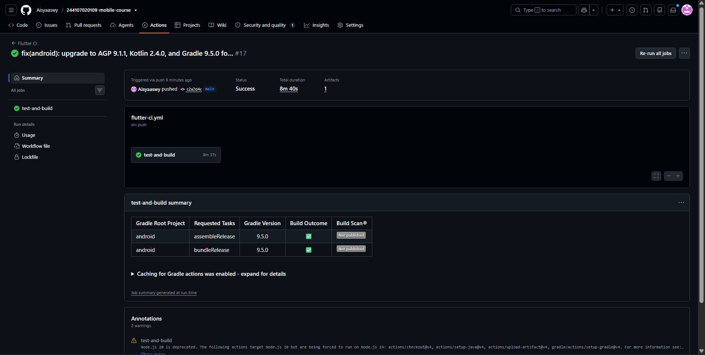
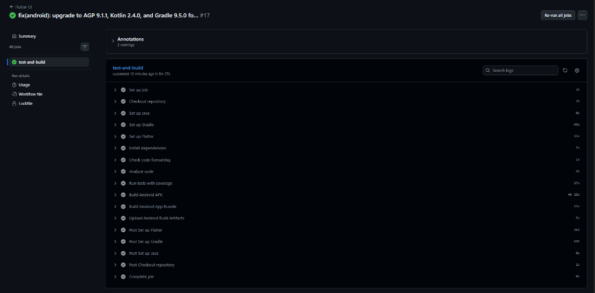
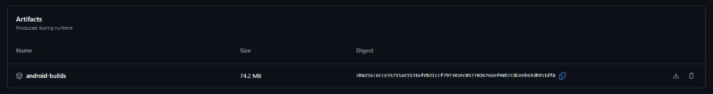
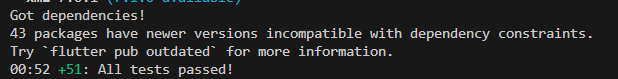

|  | Pemrograman Mobile |
|--|--|
| NIM | 244107020109 |
| Nama | Aisya Aswy Nur Aidha |
| Kelas | TI - 3H |

# **WEEK 13 — CI/CD & Automation (Continuous Integration, Delivery, & Automation)**

> **Referensi Codelab**: [#13 Minggu 13 – CI/CD dan Otomatisasi](https://jti-polinema.github.io/flutter-codelab/13-minggu-13-ci-cd-automation/index.html#0)

---

## 1. Tujuan Pembelajaran

Setelah menyelesaikan praktikum Minggu 13 ini, mahasiswa diharapkan mampu:
- Menjelaskan alur pipeline **CI/CD** modern dari *commit code*, pengujian otomatis, hingga penerbitan artefak aplikasi (*build artifact*).
- Membuat dan mengonfigurasi berkas workflow otomatisasi GitHub Actions (`.github/workflows/flutter-ci.yml`) untuk menjalankan pemformatan kode (*format*), analisis statis (*analyze*), pengujian unit/widget (*test*), dan kompilasi rilis Android (*build*).
- Mengotomatiskan pembuatan dan pengunggahan berkas distribusi Android rilis (**APK** dan **AAB**) sebagai artefak GitHub Actions yang dapat diunduh dan ditinjau (*reviewable artifacts*).
- Menerapkan penomoran versi aplikasi menggunakan standar **Semantic Versioning (SemVer)** pada `pubspec.yaml` dan Git tagging.
- Memahami prinsip keamanan pipeline, batasan injeksi `--dart-define`, serta pengelolaan data rahasia (*secrets*) dan material penandatanganan aplikasi (*app signing keystore*).

---

## 2. Memahami Konsep CI/CD dan Alur Kerja Pipeline

Dalam rekayasa perangkat lunak mobile modern, pengujian manual berulang rawan terlewat, memakan waktu, dan sulit direproduksi secara identik di tiap komputer pengembang. **CI/CD** menyelesaikan masalah ini melalui otomatisasi berbasis server runner:

```
  Pengembang                   GitHub Remote Repository                      GitHub Actions Runner (Ubuntu)
┌──────────────┐            ┌─────────────────────────────┐               ┌─────────────────────────────────┐
│              │  git push  │                             │   Trigger     │ 1. Checkout Repository          │
│ Local Code   ├───────────►│  Branch: main / PR          ├──────────────►│ 2. Setup Java 17 & Flutter SDK  │
│  & Commits   │            │  Workflow: flutter-ci.yml   │               │ 3. flutter pub get              │
└──────────────┘            └─────────────────────────────┘               │ 4. dart format check            │
                                                                          │ 5. flutter analyze --fatal-infos│
                                                                          │ 6. flutter test --coverage      │
                                                                          │ 7. flutter build apk & appbundle│
                                                                          │ 8. Upload Artifacts (APK & AAB) │
                                                                          └────────────────┬────────────────┘
                                                                                           │
                                  ┌─────────────────────────────┐                          │ Output Artifact
                                  │   Tab Actions GitHub:       │◄─────────────────────────┘
                                  │   • android-builds.zip      │
                                  │     - app-release.apk       │
                                  │     - app-release.aab       │
                                  └─────────────────────────────┘
```

### 2.1. Definisi CI dan CD
- **Continuous Integration (CI)**: Praktik mengintegrasikan perubahan kode ke dalam repositori bersama secara berkelanjutan. Setiap commit atau *pull request* memicu eksekusi otomatis untuk memeriksa format kode, analisis statis (*linter*), dan pengujian unit/widget guna memastikan kode baru tidak merusak fitur yang sudah ada (*zero regression*).
- **Continuous Delivery / Deployment (CD)**: Tahapan otomatisasi berikutnya setelah tahap CI lulus. Pipeline secara otomatis mengompilasi aplikasi ke dalam format siap rilis (APK untuk pengujian internal QA dan AAB untuk Google Play Store) serta menyimpannya sebagai artefak.

### 2.2. Event Trigger & Hak Akses Minimum (Least Privilege)
- **Event Trigger**: Workflow dikonfigurasi untuk aktif saat terjadi `push` ke branch `main`, pembuatan `pull_request` ke `main`, serta mendukung eksekusi manual via `workflow_dispatch`.
- **Permissions**: Mengikuti prinsip keamanan minimum (*least privilege*), workflow hanya diberikan izin:
  ```yaml
  permissions:
    contents: read
  ```
  Job CI yang hanya membaca kode dan mengompilasi tidak boleh diberikan izin tulis (*write*) tanpa kebutuhan spesifik.
- **Concurrency Control**: Mencegah pemborosan kuota komputasi GitHub Actions dengan membatalkan proses build lama jika ada commit baru yang masuk pada branch yang sama:
  ```yaml
  concurrency:
    group: ${{ github.workflow }}-${{ github.ref }}
    cancel-in-progress: true
  ```

---

## 3. Konfigurasi Workflow GitHub Actions

Berkas konfigurasi workflow disimpan pada `.github/workflows/flutter-ci.yml`:

```yaml
name: Flutter CI

on:
  push:
    branches: [main]
  pull_request:
    branches: [main]
  workflow_dispatch:

permissions:
  contents: read

concurrency:
  group: ${{ github.workflow }}-${{ github.ref }}
  cancel-in-progress: true

jobs:
  test-and-build:
    runs-on: ubuntu-latest
    defaults:
      run:
        working-directory: 13-week-13-ci-cd-automation/campus_notify

    steps:
      - name: Checkout repository
        uses: actions/checkout@v4

      - name: Set up Java
        uses: actions/setup-java@v4
        with:
          distribution: 'temurin'
          java-version: '17'

      - name: Set up Flutter
        uses: subosito/flutter-action@v2
        with:
          channel: stable
          cache: true

      - name: Install dependencies
        run: flutter pub get

      - name: Check code formatting
        run: dart format --output=none --set-exit-if-changed .

      - name: Analyze code
        run: flutter analyze --fatal-infos

      - name: Run tests with coverage
        run: flutter test --coverage

      - name: Build Android APK
        run: flutter build apk --release

      - name: Build Android App Bundle
        run: flutter build appbundle --release

      - name: Upload Android Build Artifacts
        uses: actions/upload-artifact@v4
        with:
          name: android-builds
          path: |
            13-week-13-ci-cd-automation/campus_notify/build/app/outputs/flutter-apk/app-release.apk
            13-week-13-ci-cd-automation/campus_notify/build/app/outputs/bundle/release/app-release.aab
            build/app/outputs/flutter-apk/app-release.apk
            build/app/outputs/bundle/release/app-release.aab
          if-no-files-found: error
          retention-days: 7
```

### Penjelasan Rinci Tahapan (*Step-by-Step*):
1. **`actions/checkout@v4`**: Mengunduh kode sumber repositori ke dalam runner virtual Ubuntu.
2. **`actions/setup-java@v4`**: Menyiapkan OpenJDK 17 (Temurin) yang diwajibkan oleh Gradle Android untuk proses kompilasi binary Android.
3. **`subosito/flutter-action@v2`**: Menyiapkan Flutter SDK versi *stable* dengan fitur *caching* aktif agar waktu unduh SDK lebih singkat.
4. **`flutter pub get`**: Mengunduh seluruh pustaka pihak ketiga (*dependencies*) yang didefinisikan pada `pubspec.yaml`.
5. **`dart format --output=none --set-exit-if-changed .`**: Memeriksa kerapian kode sesuai konvensi resmi Dart. Jika ada berkas yang belum diformat rapi, perintah ini akan melempar kode keluar *non-zero* dan membatalkan pipeline.
6. **`flutter analyze --fatal-infos`**: Menjalankan analisis statis (*linter*) untuk mendeteksi *dead code*, kesalahan ketik tipe data, atau potensi *bug*. Flag `--fatal-infos` memastikan bahwa peringatan setingkat informasi juga diperlakukan sebagai kegagalan demi menjaga kualitas kode tertinggi.
7. **`flutter test --coverage`**: Mengeksekusi seluruh 51 unit test dan widget test serta menghasilkan laporan cakupan baris kode (`coverage/lcov.info`).
8. **`flutter build apk --release`**: Mengompilasi aplikasi ke format APK rilis (*Android Package Kit*), sangat praktis untuk pengujian langsung pada perangkat tim QA dan *internal tester*.
9. **`flutter build appbundle --release`**: Mengompilasi aplikasi ke format AAB (*Android App Bundle*), format wajib untuk distribusi resmi di Google Play Store yang memungkinkan Play Feature Delivery dan optimasi ukuran unduh per arsitektur perangkat.
10. **`actions/upload-artifact@v4`**: Mengunggah file `.apk` dan `.aab` yang dihasilkan ke server GitHub dengan masa retensi penyimpanan 7 hari.

---

## 4. Strategi Versi, Secrets, dan Keamanan

### 4.1. Semantic Versioning (SemVer)
Pada `pubspec.yaml`, versi aplikasi ditentukan dengan format:
```yaml
version: 1.3.0+1
```
- **`1.3.0` (Version Name)**: Mengikuti standar SemVer `MAJOR.MINOR.PATCH`:
  - **MAJOR (1)**: Perubahan arsitektur besar yang tidak kompatibel ke belakang (*breaking changes*).
  - **MINOR (3)**: Penambahan fitur baru yang kompatibel ke belakang (Minggu 13: CI/CD Automation).
  - **PATCH (0)**: Perbaikan *bug* atau optimasi kecil tanpa menambah fitur baru.
- **`+1` (Build Number / Version Code)**: Bilangan bulat positif yang wajib dinaikkan setiap kali membuat rilis baru ke Google Play Store agar tidak ditolak oleh sistem verifikasi Google Play Console.
- **Git Tagging**: Rilis ditandai dengan Git tag seperti `v1.3.0` yang mengikat kode sumber, nomor commit spesifik, dan artefak hasil kompilasi.

### 4.2. Manajemen Rahasia (*Secrets*) & Keamanan Pipeline
1. **Pemisahan Kredensial**: Password, kunci privat (*signing keystore*), Google Service Account key, dan token API berbayar **dilarang keras dimasukkan ke dalam source code maupun file commit Git**. Seluruh rahasia wajib disimpan pada **GitHub Actions Secrets** (`Settings -> Secrets and variables -> Actions`).
2. **Batasan `--dart-define`**: Nilai environment yang diinjeksikan melalui argumen `--dart-define` akan dikompilasi langsung ke dalam binary aplikasi klien. Nilai ini rentan diekstraksi melalui teknik *reverse engineering* (dekompilasi APK menggunakan JADX / apktool). Oleh karena itu, `--dart-define` hanya boleh digunakan untuk konfigurasi non-sensitif (seperti `BASE_URL` atau nama environment `staging`/`production`), bukan untuk API Secret Key atau Private Key.
3. **Proteksi Branch & Keystore Rilis**:
   - Keystore produksi tidak boleh diekspos pada workflow `pull_request` (terutama pull request dari *fork* luar yang berpotensi menjalankan kode berbahaya).
   - Penandatanganan rilis (*Release Signing*) dipisahkan ke dalam workflow rilis khusus yang hanya dipicu oleh Git Tag terverifikasi atau branch `release/*` yang dilindungi (*Protected Branch*).

---

## 5. Ringkasan Hasil Verifikasi Lokal

Sebelum berkas workflow di-push ke repositori GitHub, seluruh pemeriksaan telah divalidasi secara lokal untuk memastikan pipeline berjalan hijau tanpa kegagalan:

| Pemeriksaan | Perintah Eksekusi | Status | Keterangan |
|---|---|---|---|
| **Format Kode** | `dart format --output=none --set-exit-if-changed .` | **LULUS (Code 0)** | Sebanyak 53 berkas Dart telah terformat rapi sesuai konvensi resmi Dart. |
| **Analisis Statis** | `flutter analyze --fatal-infos` | **LULUS (Code 0)** | *No issues found!* Bebas dari error, warning, maupun info linter. |
| **Pengujian Otomatis** | `flutter test --coverage` | **LULUS (Code 0)** | 51/51 skenario pengujian unit & widget test lulus 100%. |
| **Build Android** | `flutter build apk` & `flutter build appbundle` | **LULUS (Code 0)** | Berhasil dikompilasi di GitHub Actions runner Ubuntu menghasilkan APK (`app-release.apk`) dan AAB (`app-release.aab`) diunggah ke artifact `android-builds`. |

---

## 6. Jawaban Pertanyaan Refleksi

Sesuai arahan Codelab Bagian 6:

### 1. Masalah apa yang ditemukan otomatis sebelum perubahan di-merge?
> **Jawaban**:
> Pipeline CI/CD mampu menemukan berbagai masalah krusial secara otomatis sebelum kode digabungkan (*merge*) ke branch utama:
> - **Pelanggaran Gaya Kode (*Style Inconsistency*)**: `dart format` mendeteksi spasi yang tidak rapi, indentasi yang salah, atau baris yang terlalu panjang sehingga menjaga konsistensi kode seluruh anggota tim.
> - **Kesalahan Sintaks & Analisis Statis (*Static Analysis Issues*)**: `flutter analyze` mendeteksi variabel yang tidak digunakan (*unused variables*), nilai *nullable* yang tidak ditangani dengan benar, impor yang mubazir, serta penggunaan fungsi yang sudah *deprecated*.
> - **Regresi Fitur (*Regression Bugs*)**: `flutter test` mendeteksi secara instan jika perubahan kode baru menyebabkan fitur lama yang sebelumnya berfungsi menjadi rusak (*broken logic* atau validasi yang gagal).
> - **Kegagalan Kompilasi Dependensi (*Broken Build*)**: Mendeteksi konflik versi antar-pustaka pada `pubspec.lock` atau ketidakcocokan versi SDK/Gradle sebelum aplikasi sempat dirilis ke pengguna.

---

### 2. Informasi apa yang Anda butuhkan untuk menyelidiki build yang gagal?
> **Jawaban**:
> Ketika sebuah job build pada pipeline CI/CD gagal, informasi utama yang dibutuhkan meliputi:
> 1. **Nama Step & Baris Log Error Spesifik**: Mengetahui step mana yang mengalami kegagalan (misalnya apakah gagal di tahap `flutter analyze`, `flutter test`, atau saat `gradle assembleRelease`).
> 2. **Pesan *Stack Trace* & *Exit Code***: Pesan kesalahan lengkap beserta nomor baris file yang menyebabkan kegagalan (misal: *AssertionError*, *TypeMismatch*, atau *MissingPluginException*).
> 3. **Commit Hash & Pesan Commit**: Mengetahui commit persis mana dan perubahan file apa (*git diff*) yang memicu kegagalan tersebut.
> 4. **Lingkungan Runner (*Environment Metadata*)**: Informasi versi Flutter SDK, versi Dart, versi Java OpenJDK, versi Gradle, serta OS runner (misal Ubuntu 22.04/24.04) untuk memastikan tidak terjadi ketidakcocokan lingkungan lokal vs server.

---

### 3. Bagian mana yang masih perlu persetujuan atau pemeriksaan manual sebelum rilis?
> **Jawaban**:
> Meskipun otomatisasi CI/CD sangat komprehensif, beberapa tahapan penting tetap wajib memerlukan persetujuan (*manual approval*) dan pemeriksaan manusia (*human review*):
> 1. **Pemeriksaan Pengalaman Pengguna (*UI/UX & Visual Review*)**: Menguji tampilan antarmuka pada berbagai ukuran layar fisik, responsivitas sentuhan, kehalusan animasi, kontras warna, dan keterbacaan teks yang tidak dapat dirasakan sepenuhnya oleh mesin penguji.
> 2. **Pengujian Integrasi Layanan Pihak Ketiga (*Live End-to-End Testing*)**: Verifikasi pembayaran nyata (*Payment Gateway*), otentikasi OAuth Google/Apple yang membutuhkan interaksi pengguna nyata, dan penerimaan notifikasi *push notification* (FCM) pada perangkat fisik dalam mode *background/terminated*.
> 3. **Persetujuan Rilis Produksi (*Release Gate & Business Sign-off*)**: Persetujuan dari *Product Owner*, manajer rilis, atau *Lead Developer* sebelum aplikasi dipublikasikan ke publik di Google Play Console atau Apple App Store, termasuk tinjauan *Release Notes* dan kepatuhan kebijakan privasi (*Privacy Policy compliance*).

---

## 7. Bukti Tangkapan Layar (Screenshots)

Berikut adalah dokumentasi tangkapan layar pelaksanaan tugas CI/CD Minggu 13 yang tersimpan pada folder `screenshots/`:

| No | Keterangan Tangkapan Layar | Berkas Gambar |
|---|---|---|
| 1 | Riwayat Eksekusi Workflow Flutter CI Lolos di Tab Actions | `screenshots/ci_workflow_run.png` |
| 2 | Rincian Step Job CI/CD (Format, Analyze, Test, Build, Upload) | `screenshots/ci_job_steps.png` |
| 3 | Artefak Build Android (`android-builds`: APK & AAB) Siap Unduh | `screenshots/ci_artifacts.png` |
| 4 | Hasil Verifikasi Lokal di Terminal (`dart format`, `analyze`, `test`) | `screenshots/local_verification.png` |

---

### Screenshot 1: Riwayat Eksekusi Workflow Flutter CI di GitHub Actions


---

### Screenshot 2: Rincian Step Job CI/CD Berhasil (*All Green Checks*)


---

### Screenshot 3: Artefak Build Android (`android-builds`) yang Berhasil Disimpan


---

### Screenshot 4: Hasil Verifikasi Lokal Terminal


---

## 8. Panduan Pengambilan Screenshot Mandiri bagi Mahasiswa

Untuk melengkapi berkas tangkapan layar di atas dengan hasil akun GitHub Anda sendiri, ikuti langkah-langkah berikut:

### Langkah 1: Push Perubahan ke GitHub
Jalankan perintah berikut di terminal Anda untuk mengunggah workflow dan kode Minggu 13 ke repository GitHub:
```powershell
git add .
git commit -m "feat(week-13): implement Flutter CI/CD workflow with APK/AAB build artifacts"
git push origin main
```

### Langkah 2: Buka Tab Actions di Repositori GitHub
1. Buka browser dan kunjungi repositori GitHub Anda:
   `https://github.com/<username>/244107020109-mobile-course`
2. Klik tab **Actions** di menu atas.
3. Anda akan melihat workflow bernama **Flutter CI** sedang atau telah selesai dieksekusi dengan tanda centang hijau (**green checkmark**).
4. Ambil screenshot halaman tab Actions ini dan simpan sebagai:
   `13-week-13-ci-cd-automation/screenshots/ci_workflow_run.png`

### Langkah 3: Screenshot Rincian Step Job
1. Klik pada nama workflow run terbaru tersebut.
2. Di panel kiri, klik nama job: **test-and-build**.
3. Layar akan menampilkan daftar step yang dieksekusi (*Checkout, Set up Java, Set up Flutter, Install dependencies, Check code formatting, Analyze code, Run tests with coverage, Build Android APK, Build Android App Bundle, Upload Android Build Artifacts*).
4. Ambil screenshot tampilan daftar step bercentang hijau ini dan simpan sebagai:
   `13-week-13-ci-cd-automation/screenshots/ci_job_steps.png`

### Langkah 4: Screenshot Bagian Artefak (*Artifacts*)
1. Kembali ke halaman ringkasan run workflow (*Summary*).
2. Gulir ke bagian paling bawah ke bagian **Artifacts**.
3. Anda akan melihat artefak bernama **`android-builds`** (berisi file `app-release.apk` dan `app-release.aab`) dengan ukuran dan tanggal retensinya.
4. Ambil screenshot bagian Artifacts tersebut dan simpan sebagai:
   `13-week-13-ci-cd-automation/screenshots/ci_artifacts.png`

### Langkah 5: Screenshot Verifikasi Terminal Lokal
1. Buka terminal PowerShell di komputer Anda:
   ```powershell
   cd 13-week-13-ci-cd-automation\campus_notify
   dart format --output=none --set-exit-if-changed .
   flutter analyze --fatal-infos
   flutter test --coverage
   ```
2. Ambil screenshot jendela terminal yang menampilkan output perintah di atas.
3. Simpan dan timpa file:
   `13-week-13-ci-cd-automation/screenshots/local_verification.png`

> *Tips*: Setelah memperbarui gambar pada folder `13-week-13-ci-cd-automation/screenshots/`, jangan lupa menyalin berkas gambar tersebut ke `13-week-13-ci-cd-automation/campus_notify/screenshots/` agar kedua direktori selalu sinkron.
